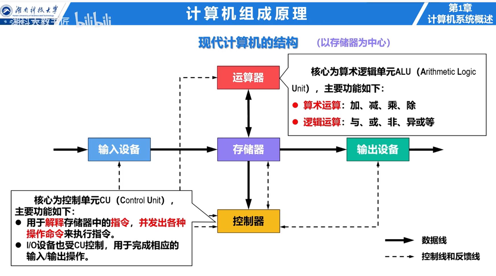
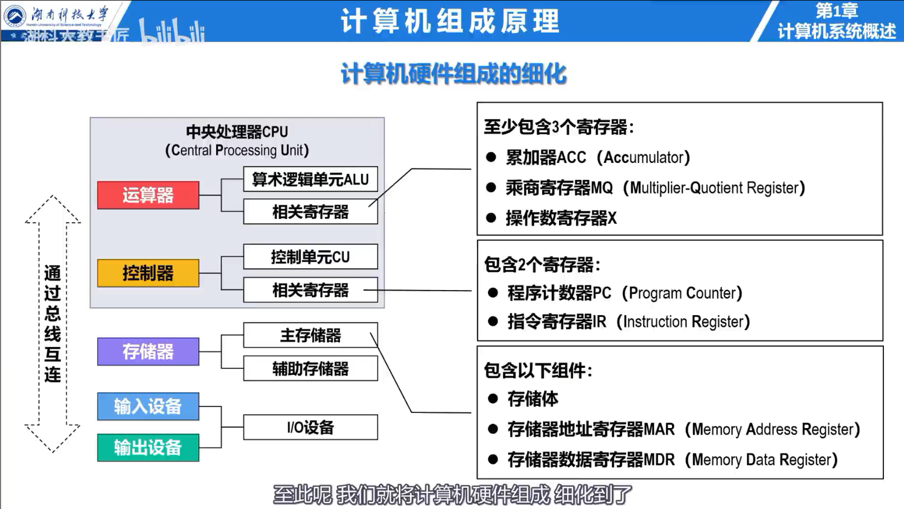

## 计算机系统的组成

计算机系统由**硬件**和**软件**组成。硬件执行机器指令，软件包括系统软件和应用软件。系统软件直接管理硬件并为应用提供服务，例如操作系统、编译程序和数据库管理系统。

冯·诺依曼结构的要点是：

- 程序和数据以二进制形式存放在同一存储器中；
- 指令由操作码和地址码组成；
- 控制器按地址顺序取指，除非转移指令改变执行顺序；
- 计算机以运算器为中心。现代系统通常以存储器为中心组织数据传送。

硬件的五个基本部件是运算器、控制器、存储器、输入设备和输出设备。运算器与控制器合称 CPU，CPU 与主存合称主机。

## 计算机系统的层次

从下到上可分为微程序机器、传统机器语言机器、操作系统机器、汇编语言机器和高级语言机器。下层是上层的实现基础，上层通过抽象隐藏下层细节。ISA 位于硬件与软件的交界处，规定指令、寄存器、数据类型、寻址方式和异常行为。

## 存储程序的工作过程

程序执行前，指令和数据先装入主存。CPU 重复执行取指、译码和执行；程序计数器 PC 保存下一条指令的地址。

## 性能指标

- **机器字长**：CPU 一次能够处理的二进制数据位数，通常与通用寄存器宽度有关。
- **主频**：时钟脉冲的频率；时钟周期是主频的倒数。
- **CPI**：执行一条指令平均需要的时钟周期数。
- **吞吐量**：单位时间完成的任务数。
- **响应时间**：完成一个任务所需的总时间。

$$
T_{CPU}=\frac{\text{指令数}\times CPI}{\text{主频}}
$$

$$
MIPS=\frac{\text{主频}}{CPI\times 10^6}
$$

### 例题：计算 CPU 执行时间

某程序包含 $5\times10^8$ 条指令，平均 CPI 为 1.2，处理器主频为 3 GHz，则 $T_{CPU}=0.2\text{ s}$。若只将占执行时间 40% 的部分加速 4 倍，根据 Amdahl 定律：

$$
S=\frac{1}{(1-0.4)+0.4/4}=\frac{10}{7}\approx1.43
$$
