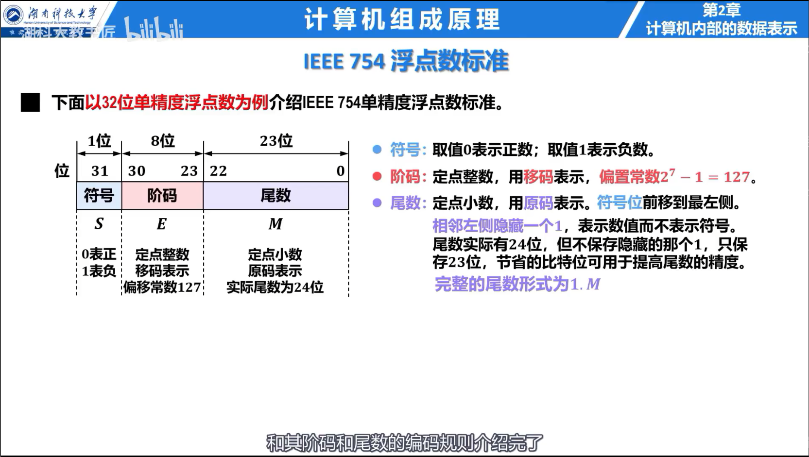

## 数制与信息单位

$r$ 进制数的每一位权值为 $r^i$。二、八、十六进制之间可按 3 位或 4 位二进制分组转换。十进制整数转换为其他进制使用除基取余，小数使用乘基取整。

- 1 B = 8 bit；
- 字是 CPU 一次处理的数据单位，字长由机器决定；
- 存储容量常用 $2^{10}$ 进位，传输速率通常用 $10^3$ 进位。

## 大端与小端

大端方式把最高有效字节放在低地址，小端方式把最低有效字节放在低地址。端序只改变字节在内存中的排列，不改变寄存器中的数值。

## 定点数编码

| 编码 | 零的个数 | $n$ 位整数的表示范围 |
| --- | ---: | --- |
| 原码 | 2 | $-(2^{n-1}-1)$ 到 $2^{n-1}-1$ |
| 反码 | 2 | $-(2^{n-1}-1)$ 到 $2^{n-1}-1$ |
| 补码 | 1 | $-2^{n-1}$ 到 $2^{n-1}-1$ |
| 移码 | 1 | $-2^{n-1}$ 到 $2^{n-1}-1$ |

正数的原码、反码和补码相同。负数的反码由原码数值位取反得到，补码等于反码加 1。补码的相反数可对全部位取反再加 1。移码常用于阶码，同一位宽下移码与补码只差符号位。

### 例题：求补码

用 8 位补码表示 $-18$：$18=00010010_2$，全部位取反再加 1，得到 $11101110_2$。

## IEEE 754 浮点数

单精度包含 1 位符号、8 位阶码和 23 位尾数；双精度包含 1 位符号、11 位阶码和 52 位尾数。规格化数为：

$$
(-1)^S\times(1.M)_2\times2^{E-\text{Bias}}
$$

单精度 Bias 为 127，双精度为 1023。

阶码全 0 表示零或非规格化数，阶码全 1 表示无穷或 NaN。非规格化数没有隐含的整数位 1。

### 例题：编码十进制数

$5.75=101.11_2=1.0111_2\times2^2$。符号位为 0，单精度阶码为 $2+127=129=10000001_2$，尾数从 `0111` 开始，其余补 0。

## C 语言中的数据

相同位模式按有符号数与无符号数解释时数值可能不同。窄类型转宽类型时，有符号数符号扩展，无符号数零扩展。完整语言规则见 [C 语言：基本类型与存储](../C-Language/01-program-types-and-storage.md)。
