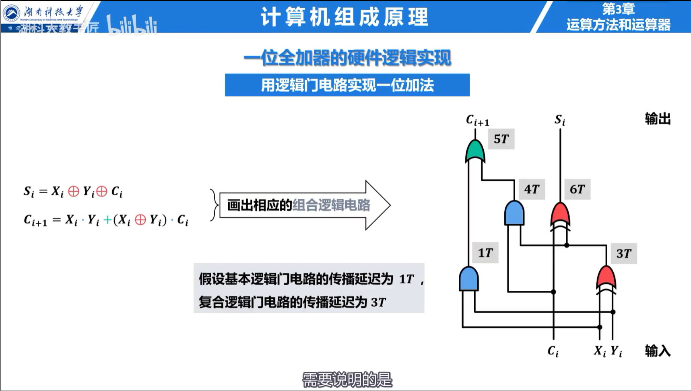

## 移位运算

逻辑移位空位补 0；算术右移保持符号位，空位补符号位；算术左移低位补 0。对不溢出的补码整数，左移一位相当于乘 2，右移一位相当于向负无穷方向除以 2。

## 补码加减法

在模 $2^n$ 意义下，补码加减法可统一为加法：

$$
[x-y]_{补}=[x]_{补}+[-y]_{补}\pmod{2^n}
$$

符号相同的两个数相加才可能溢出。双符号位判断中，结果的两个符号位不同表示溢出。单符号位判断可用最高数值位的进位与符号位进位异或：

$$
V=C_n\oplus C_{n-1}
$$

### 例题：判断溢出

8 位补码中，$100+60$ 对应 `01100100 + 00111100 = 10100000`。两个正数相加得到负数，发生正溢出；真实结果 160 超出上限 127。

## 乘法与除法

无符号乘法反复执行“判断乘数最低位、条件加被乘数、移位”。补码 Booth 乘法根据相邻两位决定加、减或不操作，适合连续的 1。

除法通过比较余数与除数，反复减法并确定商位。恢复余数法在减成负数后加回除数；不恢复余数法下一步改做加法。除数为 0、商超出目标位宽均需单独处理。

## 加法器

一位全加器输入 $A_i$、$B_i$ 和低位进位 $C_i$：

$$
S_i=A_i\oplus B_i\oplus C_i
$$

$$
C_{i+1}=A_iB_i+(A_i\oplus B_i)C_i
$$

串行进位加法器结构简单，但高位必须等待低位进位。先行进位加法器定义生成信号 $G_i=A_iB_i$ 和传递信号 $P_i=A_i\oplus B_i$，并行展开各级进位，以增加硬件为代价缩短延迟。

加减法器用控制信号同时决定是否将 $B$ 取反以及最低位是否加 1，因此同一套加法电路可完成 $A+B$ 与 $A-B$。
