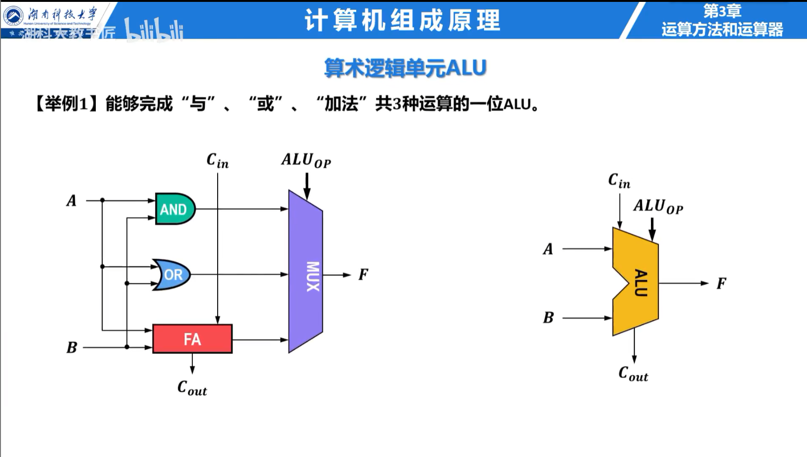

## 浮点加减法

浮点加减按以下顺序完成：

1. **对阶**：小阶向大阶看齐，小阶数的尾数右移；
2. **尾数运算**：按符号执行加法或减法；
3. **规格化**：结果最高有效位不符合规格时调整尾数和阶码；
4. **舍入**：根据保护位、舍入位和粘滞位处理被丢弃部分；
5. **溢出判断**：阶码过大为上溢，过小可能成为非规格化数或零。

采用就近舍入时，恰好位于两个可表示数中间的结果舍入到尾数最低位为偶数者，可以避免统计偏差。

### 例题：浮点数相加

计算 $1.01_2\times2^3+1.10_2\times2^1$。第二个数对阶后为 $0.0110_2\times2^3$，尾数相加得到 $1.1000_2\times2^3$，已经规格化，结果为 $1100_2=12$。

## 算术逻辑单元

ALU 根据控制信号执行加、减、与、或、异或、移位和比较。输入通常来自寄存器，结果写回寄存器或送往存储器地址部件。

常见状态标志为：

- `ZF`：结果为 0；
- `SF`：结果最高位为 1；
- `CF`：无符号加法产生进位，或减法产生借位；
- `OF`：有符号运算溢出。

`CF` 用于判断无符号数是否越界，`OF` 用于判断有符号数是否越界。例如 8 位加法 `11111111 + 00000001 = 00000000` 的 `CF=1`、`OF=0`。
