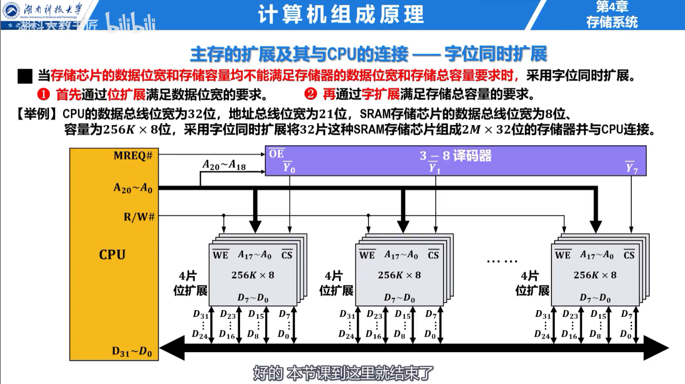

## 存储器层次与分类

寄存器、Cache、主存和辅存构成存储层次。越靠近 CPU，速度越快、单位容量成本越高、容量越小。Cache—主存层次缓解 CPU 与主存的速度差，主存—辅存层次扩大可用地址空间。

按存储介质和访问特性，存储器可分为易失性与非易失性、随机访问与顺序访问、读写存储器与只读存储器。

## SRAM、DRAM 与 ROM

SRAM 用双稳态触发器保存一位，不需要刷新，速度快、成本高，常用于 Cache。DRAM 用电容保存电荷，需要定期刷新，集成度高，常用于主存。DRAM 刷新以行为单位，可采用集中刷新、分散刷新或异步刷新。

ROM 断电后信息不丢失。MROM 出厂固化，PROM 只能写入一次，EPROM 可紫外线擦除，EEPROM 可电擦除，Flash 按块擦除。

## 存储芯片扩展

- **位扩展**：多个芯片共享地址线和片选线，分别提供数据字的不同位；
- **字扩展**：多个芯片共享数据线和低位地址线，高位地址经译码选择芯片；
- **字位同时扩展**：先组成满足字长的一组，再扩展字数。

### 例题：芯片数量与地址线

用 $1K\times4$ 位芯片组成 $4K\times8$ 位存储器。位扩展需要 $8/4=2$ 片为一组，字扩展需要 $4K/1K=4$ 组，共 8 片。片内地址需要 10 位，另外 2 位用于选择 4 组芯片。

## 多模块存储器

单体多字存储器一次读出多个连续字，但不能灵活处理跨字访问。多体并行存储器把地址分散到多个模块：高位交叉适合并行访问独立程序，低位交叉让连续地址落到不同模块，适合流水式读取连续数据。
