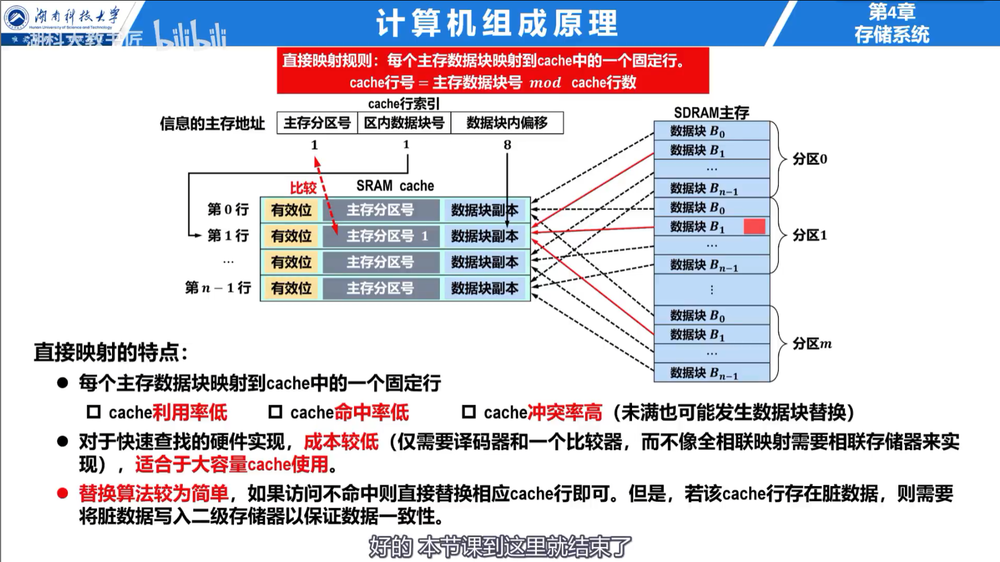
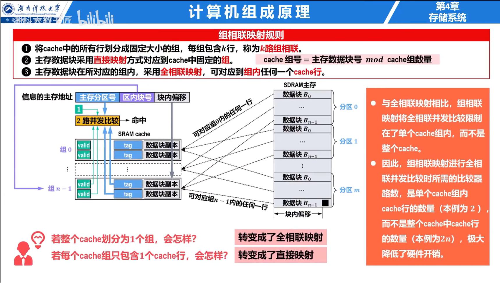

## 局部性与基本结构

时间局部性表示近期访问的数据可能再次访问，空间局部性表示相邻地址可能很快被访问。Cache 与主存按等大的块交换数据；Cache 中存放一块的位置称为行。每行还保存有效位、标记和可能的脏位。

平均访存时间为：

$$
AMAT=T_{hit}+(1-H)\times T_{miss}
$$

其中 $H$ 为命中率，$T_{miss}$ 是未命中额外代价。

## 地址映射

### 直接映射

主存块 $j$ 只能放入 Cache 行 $j\bmod C$，地址划分为标记、行号和块内偏移。硬件简单，但容易发生冲突不命中。

### 全相联与组相联

全相联允许主存块进入任意行，冲突少但比较电路昂贵。$k$ 路组相联先按块号确定组，再在组内任意选择一行，是两者折中。

### 例题：地址字段划分

32 位按字节编址，Cache 为 32 KiB，块大小 64 B，采用 4 路组相联。块内偏移为 $\log_2 64=6$ 位；共有 $32\text{ KiB}/64/4=128$ 组，组号为 7 位；标记为 $32-6-7=19$ 位。

## 替换与写策略

直接映射无需选择替换行。组相联和全相联常用 LRU、FIFO、随机替换；LRU 效果较好，但相联度高时实现成本上升。

写直达在命中时同时修改 Cache 和主存，通常配合写缓冲；写回只修改 Cache，并在脏块被替换时写主存。写不命中可采用写分配或非写分配。常见组合是“写回 + 写分配”和“写直达 + 非写分配”。

### 例题：平均访存时间

Cache 命中时间为 2 ns，命中率 95%，未命中额外需要 60 ns：

$$
AMAT=2+0.05\times60=5\text{ ns}
$$
