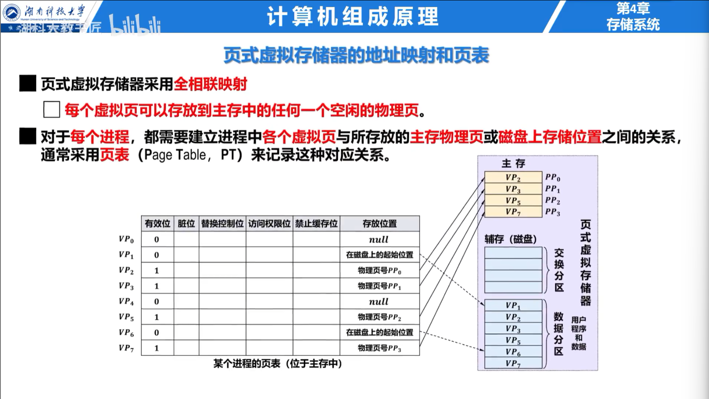
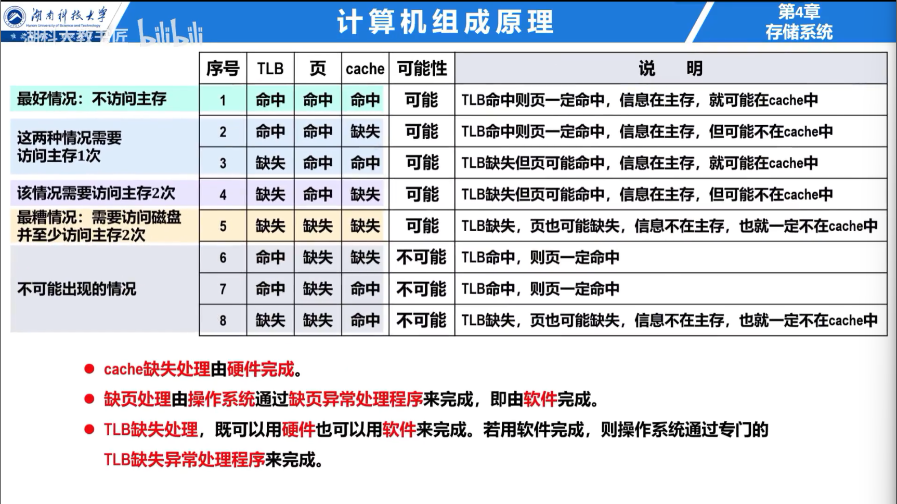

## 页式虚拟存储器

虚拟地址空间按页划分，物理内存按同样大小的页框划分。虚拟地址由虚页号和页内偏移组成；页表把虚页号映射为物理页框号，页内偏移在转换前后不变。

页表项通常包含有效位、访问权限、脏位、访问位和物理页框号。有效位为 0 时发生缺页异常，操作系统从辅存调入页面；若没有空闲页框，还要选择页面换出。

## TLB

TLB 是页表项的高速缓存。TLB 命中时直接得到物理页框号；TLB 未命中但页表命中时，硬件或操作系统读取页表并回填 TLB；页表项无效才是缺页。**TLB 未命中不等于缺页。**

地址翻译得到物理地址后，再用物理地址访问 Cache。若 Cache 使用虚拟索引、物理标记，索引 Cache 与查询 TLB 可部分并行，但要保证索引位不超出页内偏移。

## 有效访问时间

忽略缺页，TLB 查询为 $t_T$、主存访问为 $t_M$、TLB 命中率为 $h$。若 TLB 与页表访问串行：

$$
EAT=h(t_T+t_M)+(1-h)(t_T+2t_M)
$$

### 例题

$t_T=10$ ns，$t_M=100$ ns，$h=0.98$：

$$
EAT=0.98\times110+0.02\times210=112\text{ ns}
$$

页面置换、抖动和工作集属于操作系统管理内容，见 [操作系统：主存](../Operating-System/8-Main-Memory.md) 与 [虚拟内存](../Operating-System/9-Virtual-Memory.md)。
