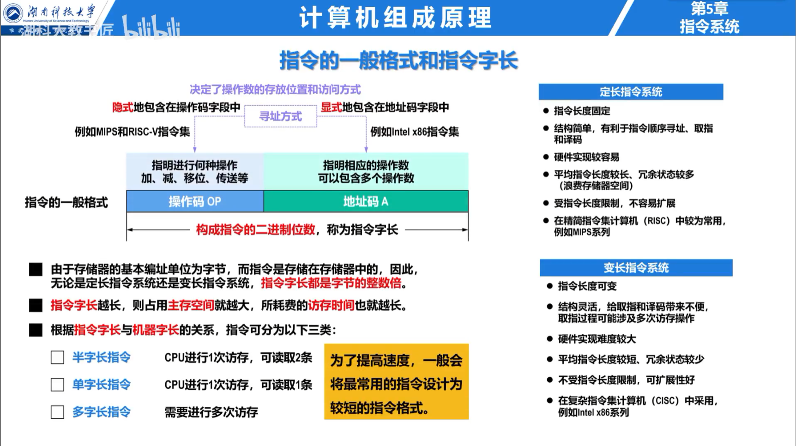
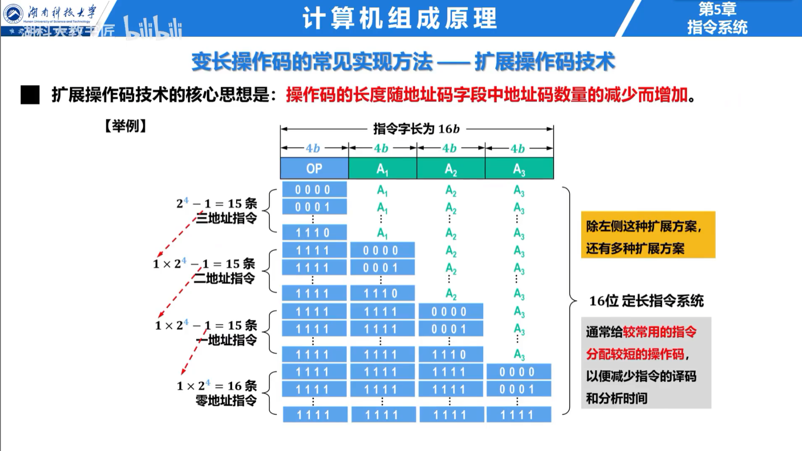

## 指令格式

一条指令至少包含操作码和地址码。操作码说明执行什么操作，地址码说明操作数位置。指令字长可以固定，也可以可变；固定长度便于取指与译码，可变长度有利于提高代码密度。

按显式地址数可分为零地址、一地址、二地址和三地址指令。地址更少并不代表无需操作数，操作数可能隐含在栈顶、累加器或固定寄存器中。

## 操作码扩展

定长操作码译码简单。扩展操作码把某些地址字段用于扩展操作码，使短地址指令拥有更多编码。设计时必须保证任一短操作码都不是更长操作码的前缀。

## 寻址方式

| 方式 | 有效地址或操作数 | 特点 |
| --- | --- | --- |
| 立即寻址 | $D=A$ | 操作数在指令中，速度快、范围受字段限制 |
| 直接寻址 | $EA=A$ | 一次访存取操作数，地址范围受字段限制 |
| 间接寻址 | $EA=(A)$ | 扩大地址范围，但增加访存次数 |
| 寄存器寻址 | $D=(R)$ | 不访问主存，速度快 |
| 寄存器间接 | $EA=(R)$ | 地址范围由寄存器位宽决定 |
| 基址寻址 | $EA=(BR)+A$ | 便于程序重定位 |
| 变址寻址 | $EA=(IX)+A$ | 适合数组访问 |
| 相对寻址 | $EA=(PC)+A$ | 便于转移和位置无关代码 |

指令寻址分为顺序寻址和跳跃寻址；操作数寻址才是上表所列方式。栈寻址使用栈顶指针隐含指定操作数。

## 指令类型与风格

指令通常包括数据传送、算术逻辑、移位、控制转移、输入输出和系统控制。

RISC 强调定长、规整指令，大量通用寄存器，Load/Store 访问存储器，便于流水线；CISC 指令功能复杂、长度和寻址方式较多，代码密度高。现代处理器可能对外呈现复杂 ISA，内部再译成较规整的微操作。
