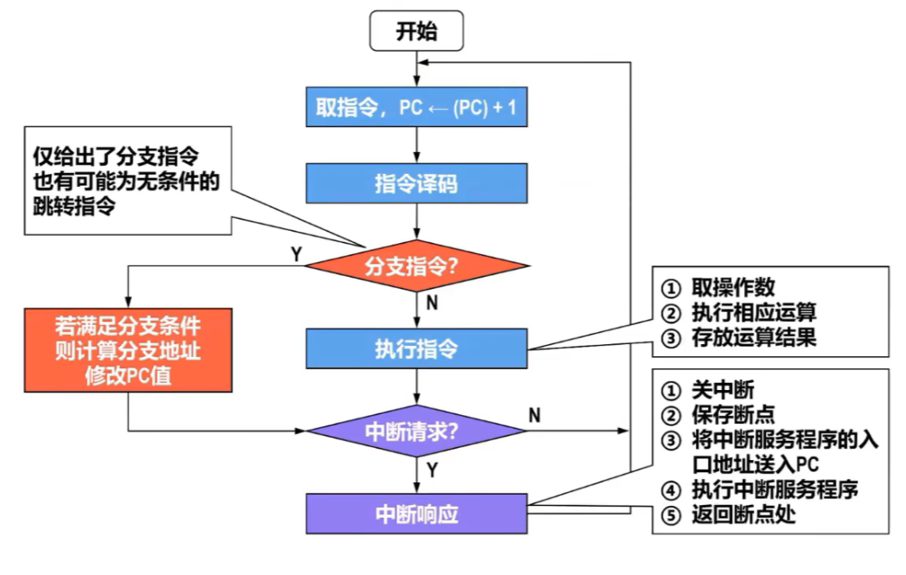
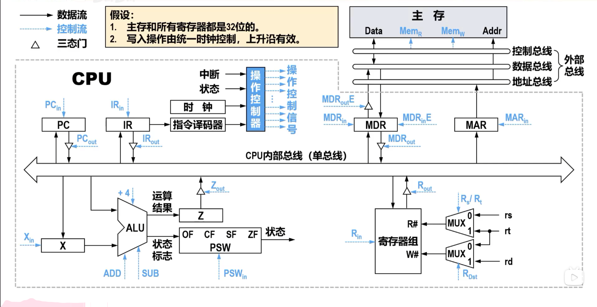

## CPU 的组成

CPU 由运算器和控制器组成。常见寄存器包括：

- `PC`：下一条指令地址；
- `IR`：当前指令；
- `MAR`：要访问的主存地址；
- `MDR`：从主存读出或准备写入的数据；
- 通用寄存器与状态寄存器。

## 指令周期

CPU 按取指、间址、执行和中断等阶段组织工作，并不是每条指令都需要全部阶段。取指完成后 PC 通常自动指向下一条指令；转移指令在执行阶段改写 PC。



## 数据通路

数据通路由寄存器、总线、ALU、多路选择器和存储器接口组成。控制器发出控制信号，决定源寄存器输出、ALU 操作和目的寄存器写入。



单总线结构每个时刻只允许一个部件驱动总线，多步微操作必须顺序完成；多总线结构可以同时读取多个操作数，但硬件更复杂。

## 微操作序列

以单总线结构中的取指为例，可写为：

```text
PC → MAR
1 → R
M(MAR) → MDR，同时 PC + 指令字长 → PC
MDR → IR
```

执行寄存器加法 `ADD R1, R2` 时，控制器先把 `R1` 送到暂存寄存器，再把 `R2` 与暂存值送入 ALU，最后把结果写回 `R1`。分析微操作时应先确定数据源、经过的组合逻辑、目的部件以及各部件是否能在同一时钟周期并行工作。
