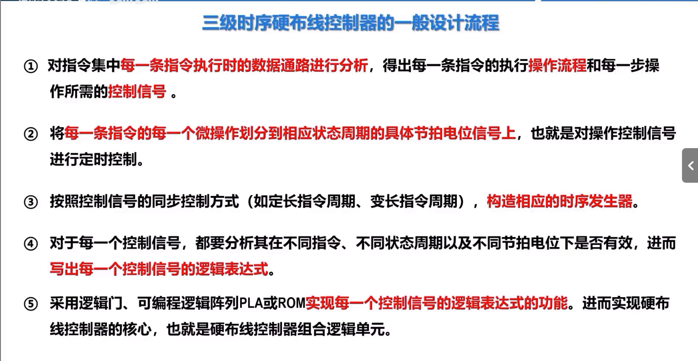
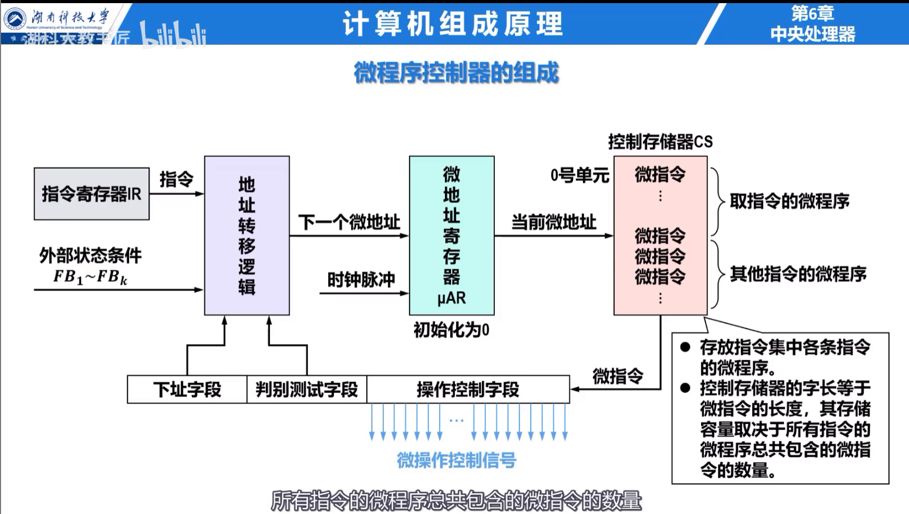

## 控制器与时序

控制器根据指令操作码、当前节拍、状态标志和外部请求生成控制信号。同步控制用统一时钟安排微操作，异步控制通过应答信号协调，联合控制在大部分操作中使用同步方式，对少数耗时不确定的部件使用异步应答。

## 硬布线控制器

硬布线控制器用组合逻辑和时序逻辑直接产生控制信号。每个信号可看作操作码、节拍和条件标志的布尔函数。

设计顺序为：列出每条指令的微操作序列，安排节拍，整理各控制信号出现的条件，化简逻辑表达式并实现电路。其速度快，适合规整的指令系统；修改或扩展指令时需要改变硬件。

## 微程序控制器

微程序控制器把控制信号编码为控制存储器中的微指令。一条机器指令对应一段微程序。

核心部件包括控制存储器 `CM`、微地址寄存器 `CMAR`、微指令寄存器 `CMDR` 和顺序逻辑。当前微指令发出控制信号，顺序逻辑结合下地址字段与条件决定下一条微指令地址。

水平型微指令并行控制能力强、字长较长；垂直型微指令编码紧凑、并行能力较弱。直接编码速度快但位数多，字段编码把互斥控制信号放在同一字段中译码，混合编码折中二者。

## 两种控制方式比较

| 项目 | 硬布线 | 微程序 |
| --- | --- | --- |
| 控制信号来源 | 逻辑电路 | 控制存储器中的微指令 |
| 速度 | 快 | 较慢 |
| 规整性 | 设计随指令复杂度上升 | 微操作序列直观 |
| 修改 | 困难 | 修改微程序较方便 |
| 常见用途 | RISC 风格控制 | 复杂指令或兼容实现 |
