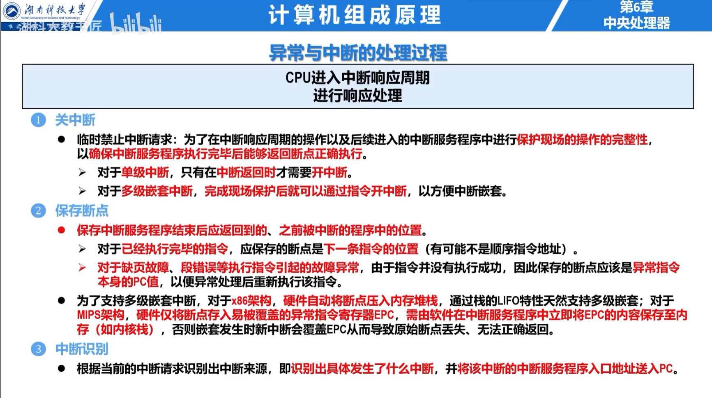

## 基本概念

**异常**由当前指令内部事件引起，例如缺页、非法指令、除零和系统调用；**中断**由外部设备或时钟引起，与当前指令本身无关。两者都会使 CPU 暂停当前控制流，转到处理程序。

异常可按返回位置分为：

- **故障 Fault**：处理后通常重新执行引发异常的指令，如缺页；
- **陷阱 Trap**：有意触发，处理后执行下一条指令，如系统调用；
- **终止 Abort**：严重错误，通常不能恢复。

可屏蔽中断受中断允许标志控制；不可屏蔽中断用于必须立即处理的严重事件。中断优先级决定同时到达时的响应顺序，中断屏蔽字决定处理中允许哪些更高优先级请求嵌套。

## 响应与处理过程

CPU 通常在一条指令执行结束后检查外部中断。响应过程为：

1. 判断请求、允许状态和优先级；
2. 保存断点与处理器状态；
3. 关闭或调整中断允许状态；
4. 根据中断向量取得处理程序入口；
5. 执行处理程序；
6. 恢复现场并执行中断返回指令。

保存 PC 和状态寄存器通常由硬件完成，保存通用寄存器通常由中断服务程序完成。中断返回不同于普通函数返回，它还必须恢复处理器状态与特权级。

I/O 中断的请求、判优和服务过程见 [I/O 控制方式与 DMA](15-io-control-and-dma.md)。
