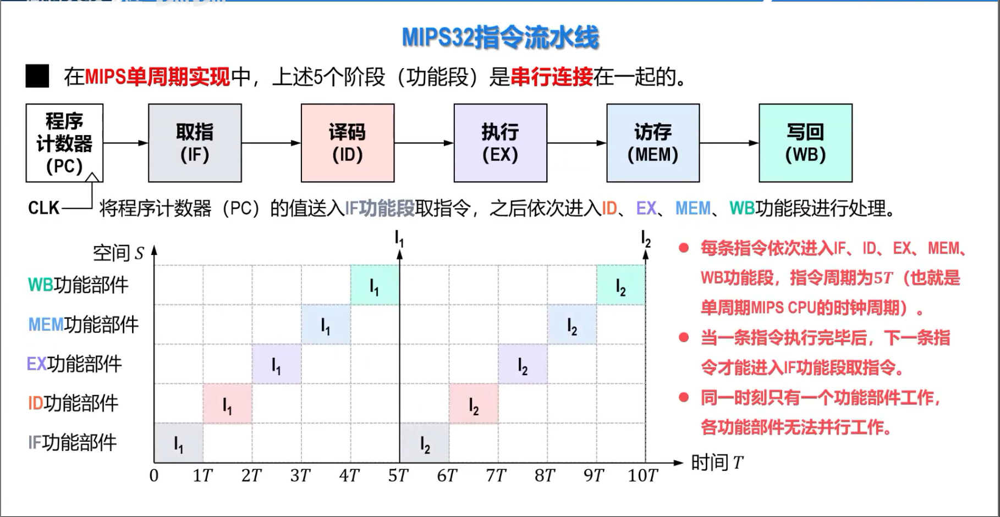
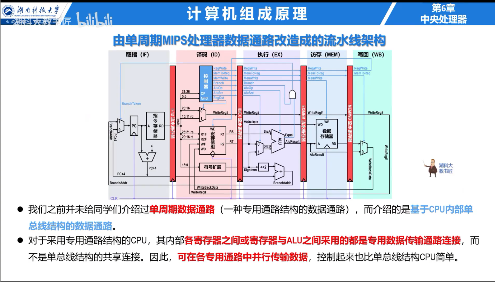
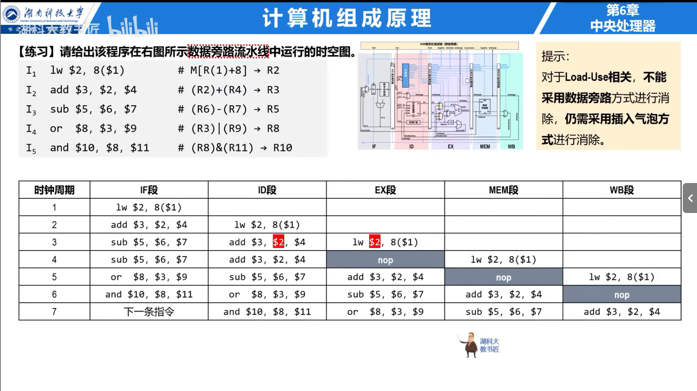

## 指令流水线

经典五级流水线把指令分为取指 `IF`、译码/读寄存器 `ID`、执行 `EX`、访存 `MEM` 和写回 `WB`。各级之间用流水寄存器保存数据和控制信号。

若每级耗时均为 $\Delta t$，$k$ 级流水线执行 $n$ 个任务的理想时间为：

$$
T_k=(k+n-1)\Delta t
$$

流水线提高吞吐率，不会缩短单条指令的延迟；实际时钟周期由最慢一级、流水寄存器延迟和时钟偏斜决定。

## 流水线冒险

- **结构冒险**：多条指令同时争用同一硬件；可增加资源或暂停流水线。
- **数据冒险**：后续指令依赖前序指令结果；顺序五级流水线主要考虑 RAW。
- **控制冒险**：分支改变 PC，在确定跳转方向前已取入错误指令。

数据旁路把后级产生的结果直接送回 EX 级，避免等待写回。Load 指令直到 MEM 级末尾才得到数据，紧随其后的使用者通常仍需暂停一个周期。

控制冒险可通过静态预测、动态分支预测、延迟转移或提前计算分支条件减少损失。预测错误时必须清除错误路径上的指令。

### 例题：流水线时间

五级流水线每级 2 ns，连续执行 100 条无冒险指令，理想时间为 $(5+100-1)\times2=208$ ns；非流水方式需要 $100\times5\times2=1000$ ns。

## 指令级与线程级并行

超标量处理器每周期发射多条指令，需要多套执行部件、相关性检查和更宽的数据通路。乱序执行允许无依赖指令越过被阻塞指令，但提交阶段仍维护程序可见的精确状态。

多核处理器在一个芯片上集成多个处理核心，依赖线程级并行。共享存储系统还必须解决 Cache 一致性；一致性只保证多个副本对同一地址的观察规则，不等同于并发程序所需的同步。
