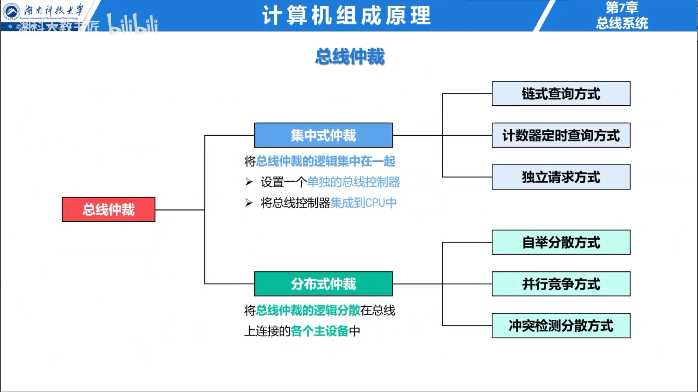
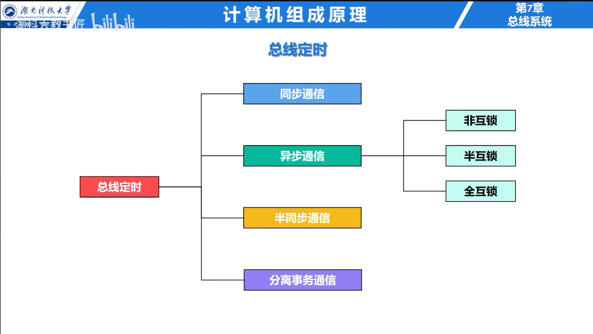

## 总线概述

总线是一组由多个部件分时共享的传输线。按传输内容可分为地址总线、数据总线和控制总线；按连接范围可分为片内总线、系统总线和通信总线。

总线宽度决定一次能传输的位数，总线工作频率和每周期传输次数共同影响带宽。地址总线宽度决定可直接寻址的地址空间。

## 总线事务

一次总线事务由请求、仲裁、寻址、数据传送和结束组成。发起事务的部件是主设备，被访问的部件是从设备。总线周期是完成一次事务所需的时间，时钟周期只是同步总线的基本时间单位，两者不能等同。

## 总线仲裁

多个主设备同时请求总线时需要仲裁。集中式仲裁由统一仲裁器决定使用权，包括链式查询、计数器查询和独立请求；分布式仲裁由各设备共同决定。

链式查询线路少但优先级固定，靠近仲裁器的设备优先；独立请求响应快且优先级灵活，但控制线多；计数器查询介于两者之间。

## 总线定时

同步定时由统一时钟规定各阶段，控制简单，适合速度接近的部件。异步定时通过请求与回答握手，能适应速度差异大的设备，但控制更复杂。半同步方式保留时钟并允许慢设备插入等待周期。

### 例题：总线带宽

总线宽度 64 位，频率 200 MHz，每周期传输 2 次，理论带宽为：

$$
\frac{64}{8}\times200\times10^6\times2=3.2\times10^9\text{ B/s}=3.2\text{ GB/s}
$$

实际带宽还会受寻址、仲裁、等待周期和协议开销影响。
