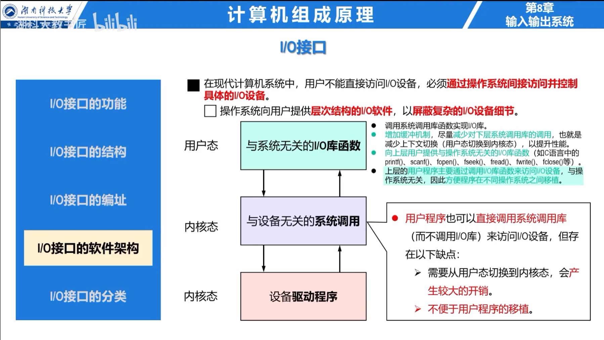

## I/O 系统

I/O 系统连接主机与外设，解决速度、数据格式和控制方式的差异。外设通常由设备本体和设备控制器组成，CPU 不直接控制机械部件，而是访问控制器中的寄存器。

I/O 软件从下到上包括中断处理程序、设备驱动程序、设备独立软件和用户层 I/O 软件。

## I/O 接口

接口的主要功能是设备选择、命令与状态传送、数据缓冲、格式转换、速度匹配和中断/DMA 请求。典型接口包含：

- **数据寄存器**：保存输入或输出数据；
- **状态寄存器**：表示就绪、忙、错误和中断状态；
- **控制寄存器**：保存 CPU 发出的命令和工作方式；
- 地址译码与控制逻辑。

## 端口编址

独立编址为 I/O 端口设置独立地址空间，需要专用 I/O 指令，不占用存储地址。统一编址把接口寄存器看作存储单元，可使用普通访存指令，编程灵活，但占用部分存储地址空间。

统一编址描述的是 CPU 如何访问接口寄存器，并不表示外设数据存放在主存中。

## 程序查询方式

CPU 向控制寄存器写命令后，反复读取状态寄存器；设备就绪时再读写数据寄存器。其硬件简单，但 CPU 忙等期间不能完成其他工作。查询循环必须先检查状态，再访问数据，不能假定设备已经完成。
