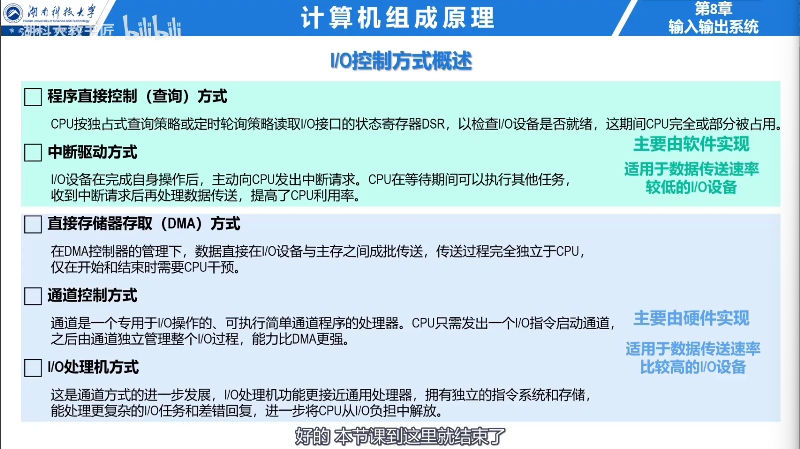
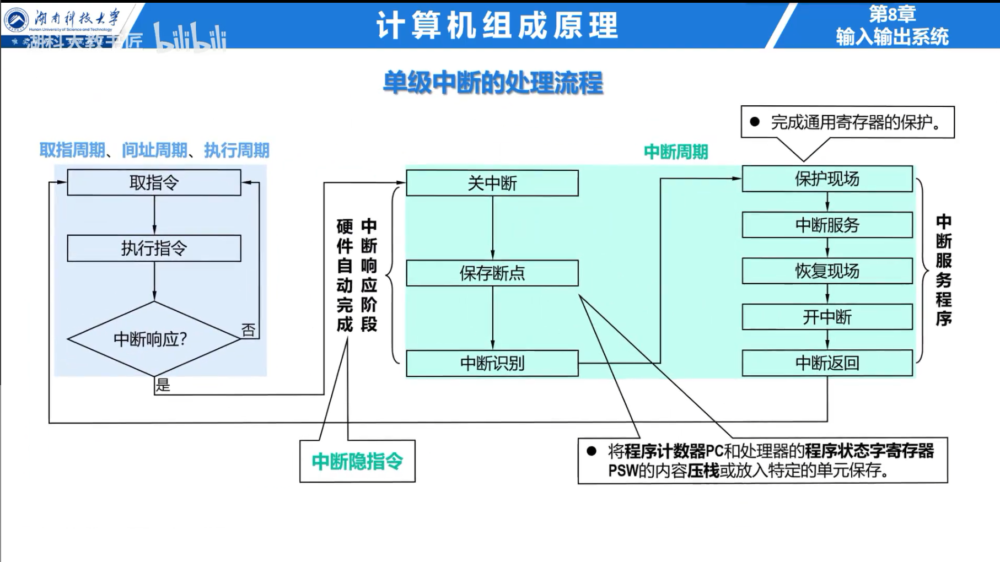
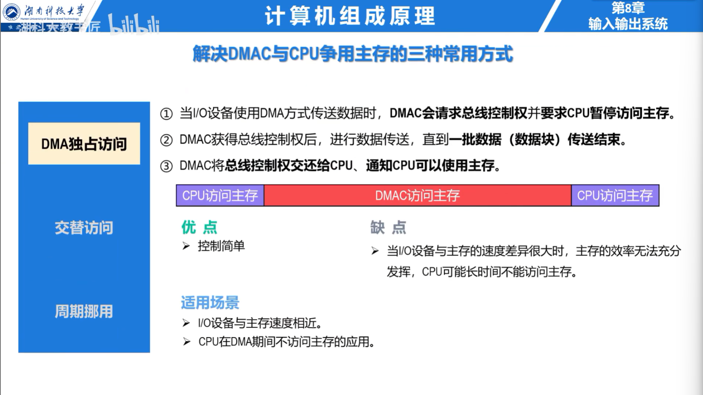

## I/O 控制方式

| 方式 | 数据经过 CPU | CPU 介入频率 | 适用场景 |
| --- | --- | --- | --- |
| 程序查询 | 是 | 每个字都查询和传送 | 简单、低速设备 |
| 中断驱动 | 是 | 每次设备就绪时中断 | 中低速、间歇传输 |
| DMA | 否 | 数据块开始和结束时 | 高速块设备 |
| 通道 | 否 | CPU 提交 I/O 程序 | 大型系统、多设备 |

## 中断驱动 I/O

CPU 发出命令后继续执行其他程序。设备准备好数据时发出中断请求，CPU 保存现场并进入中断服务程序，由程序在设备接口与 CPU 寄存器之间传送数据。

中断隐指令由硬件完成保存断点、取得入口等操作；中断服务程序负责保护通用寄存器、服务设备、恢复现场并返回。异常与中断的分类见 [异常与中断](11-exceptions-and-interrupts.md)。

## DMA

DMA 控制器通常包含主存地址寄存器、字计数器、数据缓冲寄存器和控制/状态寄存器。CPU 先设置源或目的地址、传送方向和数据量，DMA 控制器随后直接在设备与主存之间传送数据，完成后再中断 CPU。

DMA 与 CPU 共享主存端口的方式包括：

- **停止 CPU 访存**：DMA 传送期间 CPU 不访问主存；
- **周期挪用**：DMA 每次占用一个或若干存取周期；
- **交替访问**：把存储周期固定划分给 CPU 与 DMA。

DMA 只能完成预先规定的数据块传送，复杂设备管理仍由软件负责。I/O 通道能够执行通道程序并控制多台设备，独立性高于 DMA。

### 例题：DMA 对 CPU 的影响

存储器周期为 100 ns，DMA 每传送一个字挪用一个周期，设备速率为 $2\times10^6$ 字/s。DMA 每秒占用主存的时间为：

$$
2\times10^6\times100\text{ ns}=0.2\text{ s}
$$

若 CPU 的全部工作都需要访问该单端口主存，可用访存时间最多减少 20%；实际 CPU 性能下降还取决于 Cache 命中率和计算阶段是否需要主存。
