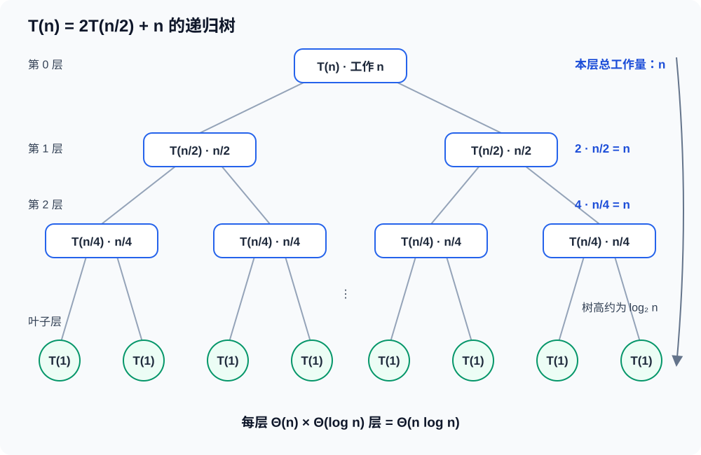

# Complexity Analysis 复杂度分析

## 1. 分析对象

- 时间复杂度 $T(n)$：输入规模为 $n$ 时，基本操作次数的增长量级。
- 空间复杂度 $S(n)$：算法运行时额外使用的空间增长量级；竞赛中通常说的是**辅助空间**，不计输入本身。
- 必须先明确 $n$ 的含义：数组长度、顶点数 $|V|$、边数 $|E|$、字符串长度、状态数或数值范围。

复杂度描述增长趋势，不是实际秒数。常数、语言、缓存和实现会影响运行时间，但不会改变渐进阶。

## 2. 渐进记号

| 记号 | 含义 | 使用场景 |
| --- | --- | --- |
| $O(f(n))$ | 最终不超过 $f(n)$ 的常数倍 | 常用上界，竞赛题通常报这个 |
| $\Omega(f(n))$ | 最终不少于 $f(n)$ 的常数倍 | 下界 |
| $\Theta(f(n))$ | 同时是 $O(f(n))$ 与 $\Omega(f(n))$ | 紧确界 |

忽略常数与低阶项：$3n^2+10n+1=\Theta(n^2)$，$O(2n)=O(n)$。对数底数只差常数：$\log_2n=\Theta(\log_{10}n)$。

常用增长顺序：

$$
O(1)<O(\log n)<O(\sqrt n)<O(n)<O(n\log n)<O(n^2)<O(n^3)<O(2^n)<O(n!)
$$

## 3. 循环与求和

| 代码或过程 | 时间复杂度 | 原因 |
| --- | --- | --- |
| `for (i = 0; i < n; ++i)` | $O(n)$ | 执行 $n$ 次 |
| 两层各执行 $n$ 次的嵌套循环 | $O(n^2)$ | $n\cdot n$ |
| `for (i = 1; i < n; i *= 2)` | $O(\log n)$ | $2^k\ge n$ 时结束 |
| `for (i = n; i > 0; i /= 2)` | $O(\log n)$ | 每次减半 |
| `for (j = i; j < n; ++j)` 的双层循环 | $O(n^2)$ | $\sum_{i=0}^{n-1}(n-i)$ |
| `for (j = 1; j < i; j *= 2)`，外层 $i=1\dots n$ | $O(n\log n)$ | $\sum_{i=1}^{n}\log i$ |

嵌套循环不能只看层数。例如双指针中左右指针都只单调移动：

```cpp
int left = 0;
for (int right = 0; right < n; ++right) {
    while (left < right && invalid(left, right)) {
        ++left;  // left 在整个过程最多移动 n 次。
    }
}
```

总移动次数至多 $2n$，因此是 $O(n)$，不是 $O(n^2)$。

常用求和：

$$
\sum_{i=1}^{n}1=n,\qquad
\sum_{i=1}^{n}i=\frac{n(n+1)}2=\Theta(n^2),\qquad
\sum_{i=0}^{\lfloor\log n\rfloor}2^i=\Theta(n)
$$

## 4. 递归式的时间复杂度求解

### 4.1 从递归程序写出递归式

递归式由三部分组成：产生多少个子问题、每个子问题的规模、当前调用中递归之外的工作量。设规模为 $n$ 的问题耗时为 $T(n)$，归并排序把数组分成两个长度为 $n/2$ 的子数组，并用线性时间合并，因此

$$
T(n)=2T\left(\frac n2\right)+\Theta(n),\qquad T(1)=\Theta(1)
$$

$2T(n/2)$ 表示两个递归调用的总时间，$\Theta(n)$ 表示分割、比较和合并等当前层完成的工作。分析渐进复杂度时，通常可以忽略向上或向下取整，但不能漏掉递归外的工作量。

求解递归式常用三种方法：代入法用于提出并证明一个复杂度界，递归树法用于观察每层工作量，Master 定理用于快速求解形式规则的等规模分治递归。

### 4.2 代入法

代入法的核心是“先猜测，再用数学归纳法证明”。猜测不是凭空得到的，可以先展开几层寻找规律。

以归并排序为例，暂时只保留渐进分析所需的项：

$$
T(n)=2T\left(\frac n2\right)+n
$$

连续代入右侧的 $T$：

$$
\begin{aligned}
T(n)
&=2\left(2T\left(\frac n4\right)+\frac n2\right)+n \\
&=4T\left(\frac n4\right)+2n \\
&=8T\left(\frac n8\right)+3n
\end{aligned}
$$

展开 $k$ 层后得到

$$
T(n)=2^kT\left(\frac{n}{2^k}\right)+kn
$$

当子问题规模到达 $1$ 时，$n/2^k=1$，所以 $k=\log_2n$。由此猜测 $T(n)=\Theta(n\log n)$。

接着证明上界。假设对于更小的规模有

$$
T\left(\frac n2\right)\le c\frac n2\log_2\frac n2
$$

把假设代回原递归式：

$$
\begin{aligned}
T(n)
&\le 2c\frac n2\log_2\frac n2+n \\
&=cn\log_2n-(c-1)n \\
&\le cn\log_2n \qquad (c\ge1)
\end{aligned}
$$

因此 $T(n)=O(n\log n)$。用相同方法证明 $T(n)=\Omega(n\log n)$，即可得到紧确界 $T(n)=\Theta(n\log n)$。常数 $c$ 需要取得足够大，使归纳假设也覆盖递归基 $T(1)$。

代入法不要求递归式满足 Master 定理。例如

$$
T(n)=T(n-1)+n
$$

逐层代入到 $T(1)$ 后得到

$$
T(n)=T(1)+\sum_{i=2}^{n}i=\Theta(n^2)
$$

### 4.3 递归树法

对一般形式

$$
T(n)=aT\left(\frac nb\right)+f(n)
$$

递归树第 $i$ 层有 $a^i$ 个规模为 $n/b^i$ 的子问题，因此该层递归外的总工作量为

$$
a^if\left(\frac{n}{b^i}\right)
$$

树高约为 $\log_bn$，叶子数为

$$
a^{\log_bn}=n^{\log_ba}
$$

最后把每层工作量和叶子代价相加，主导总和的部分就决定复杂度。



对于 $T(n)=2T(n/2)+n$，第 $i$ 层有 $2^i$ 个节点，每个节点的非递归工作量为 $n/2^i$，所以每层总工作量都是

$$
2^i\cdot\frac{n}{2^i}=n
$$

从根到叶子共有 $\log_2n+1$ 层，故

$$
T(n)=\underbrace{n+n+\cdots+n}_{\log_2n+1\text{ 层}}=\Theta(n\log n)
$$

如果各层代价形成等比数列，就比较公比：逐层增大时由叶子附近主导，逐层减小时由根附近主导，每层相同时还要再乘树高。

### 4.4 Master 定理

Master 定理适用于

$$
T(n)=aT\left(\frac nb\right)+f(n),\qquad a\ge1,\ b>1
$$

其中 $a$ 个子问题的规模都为 $n/b$。先计算临界项

$$
n^{\log_ba}
$$

它表示递归树叶子数量的增长量级。然后把 $f(n)$ 与临界项比较，判断递归树由哪一部分主导。

| 情况 | $f(n)$ 与 $n^{\log_ba}$ 的关系 | 递归树中的主导部分 | 结论 |
| --- | --- | --- | --- |
| 1 | $f(n)=O(n^{\log_ba-\varepsilon})$，$\varepsilon>0$ | 叶子 | $T(n)=\Theta(n^{\log_ba})$ |
| 2 | $f(n)=\Theta(n^{\log_ba}\log^kn)$，$k\ge0$ | 各层共同贡献 | $T(n)=\Theta(n^{\log_ba}\log^{k+1}n)$ |
| 3 | $f(n)=\Omega(n^{\log_ba+\varepsilon})$，$\varepsilon>0$，且满足正则条件 | 根附近 | $T(n)=\Theta(f(n))$ |

情况 3 的正则条件是：存在常数 $c<1$，使足够大的 $n$ 满足

$$
af\left(\frac nb\right)\le cf(n)
$$

三种情况分别对应不同的主导部分：

- $T(n)=4T(n/2)+n$ 的临界项是 $n^2$，$f(n)=n$ 小一个多项式因子，属于情况 1，因此 $T(n)=\Theta(n^2)$。
- 归并排序中 $a=2$、$b=2$、$f(n)=n$，临界项也是 $n$，属于情况 2，得到 $T(n)=\Theta(n\log n)$。
- $T(n)=2T(n/2)+n^2$ 的临界项为 $n$，$f(n)=n^2$ 大一个多项式因子，并且

  $$
  2f\left(\frac n2\right)=2\left(\frac n2\right)^2=\frac12n^2
  $$

  正则条件成立，属于情况 3，因此 $T(n)=\Theta(n^2)$。

使用 Master 定理时，先写出 $a$、$b$、$f(n)$，再计算临界项并逐项核对条件，不能只凭递归式的外观套结论。$T(n)=T(n-1)+f(n)$、子问题规模不等、子问题规模不是固定比例或递归过程依赖输入数据时，不能直接使用 Master 定理，应改用代入法、递归树法或更一般的 Akra–Bazzi 定理。

### 4.5 方法选择

- 遇到 $T(n-1)$、$T(n-2)$ 等逐步缩小的递归式，优先逐层代入并化为求和。
- 遇到等规模分治，先画递归树理解每层代价，再用 Master 定理快速计算。
- 需要严格证明猜测的上界或下界时，使用代入法和数学归纳法。
- 遇到规模不等的多个子问题，使用递归树估计，必要时使用 Akra–Bazzi 定理。

## 5. 空间复杂度

| 情形 | 辅助空间 |
| --- | --- |
| 若干标量变量 | $O(1)$ |
| 长度为 $n$ 的数组、哈希表、队列 | $O(n)$ |
| 邻接矩阵 | $O(|V|^2)$ |
| 邻接表 | $O(|V|+|E|)$ |
| 深度为 $d$ 的递归 | $O(d)$ 调用栈 |
| 归并排序 | $O(n)$ 辅助数组与 $O(\log n)$ 栈 |
| 原地堆排序 | $O(1)$ 额外空间 |

递归空间看**最大同时递归深度**，不是总调用次数。二分递归调用总数可达 $O(n)$，但深度只有 $O(\log n)$；深度优先遍历最坏递归深度为 $O(n)$，链状树会爆栈。

## 6. 摊还分析与均摊复杂度

摊还分析保证一段操作序列的总成本，而不是单次操作的最坏成本。

- 动态数组尾部 `push_back`：扩容某次为 $O(n)$，但容量倍增时连续 $m$ 次插入总搬移为 $O(m)$，均摊 $O(1)$。
- 单调栈：每个元素最多入栈一次、出栈一次，总操作 $O(n)$。
- 并查集：路径压缩加按秩合并的 $m$ 次操作为 $O(m\alpha(n))$，竞赛中近似 $O(m)$。

“均摊 $O(1)$”不等于“每次都是 $O(1)$”；哈希表通常写平均 $O(1)$，它依赖散列分布，和摊还不是同一个概念。

## 7. 竞赛常用复杂度与规模

下表按 C++ 常数较小、约 $10^8$ 次简单操作/秒的粗略经验估算；实际取决于时限和常数。

| $n$ 的数量级 | 通常可接受的复杂度 |
| --- | --- |
| $n\le20$ | $O(2^n)$、状态压缩枚举 |
| $n\le25$ | $O(2^{n/2})$、折半搜索 |
| $n\le10^2$ | $O(n^3)$ |
| $n\le10^3$ | $O(n^2)$，有时 $O(n^2\log n)$ |
| $n\le10^5$ | $O(n\log n)$、$O(n\sqrt n)$ |
| $n\le10^6$ | $O(n)$、$O(n\log n)$（常数要小） |
| $n\ge10^7$ | 接近 $O(n)$，并注意 I/O 与内存 |

常用算法量级：

| 算法或结构 | 时间复杂度 | 空间复杂度 |
| --- | --- | --- |
| 二分查找 | $O(\log n)$ | $O(1)$ |
| 排序 | $O(n\log n)$ | 取决于实现 |
| 前缀和预处理 / 单次查询 | $O(n)$ / $O(1)$ | $O(n)$ |
| 堆、平衡树单次操作 | $O(\log n)$ | $O(n)$ |
| 哈希表单次操作 | 平均 $O(1)$ | $O(n)$ |
| BFS / DFS 邻接表 | $O(|V|+|E|)$ | $O(|V|+|E|)$ |
| Dijkstra（二叉堆） | $O((|V|+|E|)\log|V|)$ | $O(|V|+|E|)$ |
| Floyd | $O(|V|^3)$ | $O(|V|^2)$ |

## 8. 常见误区

- 比较复杂度时先统一输入规模；图算法不能把 $|V|$ 和 $|E|$ 都写成 $n$ 后丢失信息。
- `break` 不必然降低最坏复杂度；最坏输入可能从不触发它。
- `vector` 按值传参会复制 $O(n)$，应写 `const vector<int>&`；递归中复制容器也会额外增加时间和空间。
- 位运算枚举子集的 `for (sub = mask; sub; sub = (sub - 1) & mask)` 对一个固定 `mask` 是 $O(2^{\operatorname{popcount}(mask)})$；对所有 `mask` 总计是 $O(3^n)$。
- 先判溢出和内存：$n=10^5$ 的 `int[n][n]` 不可能存下；$O(n^2)$ 也许时间能过，但空间先失败。
