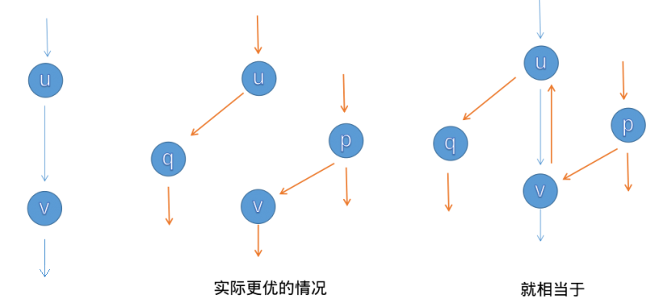

网络流把“能够转移多少资源”写成带容量的有向图。它适合运输、分配、匹配、容量限制和最小割等问题；本页只讨论最常用的最大流。

# 流网络基本概念

流网络是一张有向图。边表示资源可以移动的方向，容量表示该方向最多允许通过多少资源。

| 名称 | 记号 | 含义 |
| --- | --- | --- |
| 流网络 | $G=(V,E)$ | 点集和有向边集组成的图 |
| 源点 | $s$ | 资源从这里进入网络 |
| 汇点 | $t$ | 资源最终到达这里 |
| 容量 | $c(u,v)$ | 原图边 $(u,v)$ 最多允许通过的数量 |
| 流量 | $f(u,v)$ | 当前实际从 $u$ 送到 $v$ 的数量 |
| 流的值 | $\vert f\vert$ | 最终送入汇点的总量，也等于源点送出的总量 |

例如有边 $s\to a$（容量 `4`）、$s\to b$（容量 `3`）、$a\to t$（容量 `4`）、$b\to t$（容量 `2`）。令：

$$
f(s,a)=3,\quad f(a,t)=3,\quad f(s,b)=2,\quad f(b,t)=2
$$

这是一组流量为 `5` 的方案：`a` 收到 `3` 后也送出 `3`，`b` 收到 `2` 后也送出 `2`，没有资源凭空产生或消失。由于进入 $t$ 的总容量为 $4+2=6$，这个例子中的 `5` 还不一定是最大流。

一条边的容量和流量是不同的：容量 `4` 不表示已经送了 `4`，只表示最多能送 `4`。原图中的边有方向；除非题目明确允许双向运输，否则不能从 $v$ 沿 $(u,v)$ 反向送到 $u$。

# 可行流与流量守恒

一组流 $f$ 称为**可行流**，当且仅当它同时满足容量限制和流量守恒。

容量限制要求每条原图边上的流量不超过容量，也不能为负：

$$
0 \le f(u,v) \le c(u,v)
$$

流量守恒要求：除源点 $s$ 和汇点 $t$ 外，任意中间点 $u$ 的流入量等于流出量。

$$
\sum_{(v,u)\in E} f(v,u) = \sum_{(u,w)\in E} f(u,w)
$$

因此，中间点可以转运资源，但不能囤积或制造资源。题目若给出“某个点最多能经过 $k$ 个单位”的限制，不能直接把它当作普通边容量；应使用后文的**点拆分**建模。

# 最大流模型

给定流网络、源点 $s$ 与汇点 $t$，**最大流**是在所有可行流中，让流的值 $|f|$ 尽可能大的方案。流的值等于源点的净流出量，也等于汇点的净流入量。

容量表示上限，不是已经通过的流量。若题目有无向边，应按题意建两条独立的有向边；不要把一条无向边误写成“正反残量边”。

# 残量网络与增广路

向边 $(u,v)$ 发送 $x$ 单位流后：

- 正向剩余容量减少 $x$，之后最多还能再发送 $c(u,v)-f(u,v)$。
- 反向边增加 $x$ 的剩余容量，可以撤销先前的一部分选择。

这张由所有剩余容量大于零的边组成的图称为**残量网络**。从 $s$ 到 $t$ 的一条残量路径称为增广路，沿它能增加的量是路径上的最小剩余容量。

反向边是最大流正确性的关键。例如先把流量错误地送进某条支路后，后续可以经反向边撤销并重新分配；只允许正向增加会卡在局部选择上。



这是一张合并示意图，不是三张并列的独立流程图。最左的蓝色竖直路径表示第一次选择了经过 $u\to v$ 的增广路；中部橙色部分表示更优的两条流向；最右部分把两次增广叠加：橙色路径经过 $p\to v\to u\to q$，其中 $v\to u$ 正是由第一次增广产生的反向残量边。两次流量在 $u,v$ 之间抵消后，结果等价于中部的两条路径，总流量从 `1` 增加到 `2`。

反向边不是原图中多出的一条运输边，而是算法为修正既有选择保留的剩余容量。

图源：[OI Wiki：最大流](https://oi-wiki.org/graph/flow/max-flow/)，CC BY-SA 4.0。

# 最大流最小割

一个割把点集分为 $S,T$ 两部分，满足 $s\in S,t\in T$。从 $S$ 指向 $T$ 的边容量和称为该割容量。

最大流最小割定理：

$$
\text{最大流值}=\text{最小割容量}
$$

当残量网络中已经不存在 $s\to t$ 的路径时，令 $S$ 为从 $s$ 仍可到达的点集，$T=V\setminus S$。所有从 $S$ 到 $T$ 的原图边都已满流，它们就是一个最小割。

这给出了两种常用用途：最大流算法求出的流量就是最优答案；若题目要求“切断哪些边/最少切断多少容量”，在最终残量图中找源点可达集即可恢复割。

# Dinic 算法

Dinic 重复执行两步：

1. BFS 在残量网络中计算每个点到源点的层数，只保留从第 `d` 层到第 `d+1` 层的边，得到分层图。
2. DFS 只在分层图中增广，直到再也无法从源点送到汇点；这一轮送出的总流量称为阻塞流。

`cur[u]` 是当前弧优化：从点 `u` 再次 DFS 时，不重复检查已经证实无用的边。一般复杂度为 $O(V^2E)$，竞赛中的稀疏图通常表现良好；边容量为 `int` 时，累计答案仍建议使用 `long long`。

```cpp
#include <bits/stdc++.h>
using namespace std;

struct Dinic {
    struct Edge {
        int to;
        long long cap;
        int rev;
    };

    int n;
    vector<vector<Edge>> graph;
    vector<int> level;
    vector<int> cur;

    explicit Dinic(int n) : n(n), graph(n), level(n), cur(n) {}

    void addEdge(int from, int to, long long cap) {
        graph[from].push_back({to, cap, static_cast<int>(graph[to].size())});
        graph[to].push_back({from, 0, static_cast<int>(graph[from].size()) - 1});
    }

    bool buildLevelGraph(int source, int sink) {
        fill(level.begin(), level.end(), -1);
        queue<int> q;
        level[source] = 0;
        q.push(source);

        while (!q.empty()) {
            int u = q.front();
            q.pop();
            for (const Edge& edge : graph[u]) {
                if (edge.cap == 0 || level[edge.to] != -1) continue;
                level[edge.to] = level[u] + 1;
                q.push(edge.to);
            }
        }
        return level[sink] != -1;
    }

    long long sendFlow(int u, int sink, long long limit) {
        if (u == sink) return limit;

        for (int& i = cur[u]; i < graph[u].size(); i++) {
            Edge& edge = graph[u][i];
            if (edge.cap == 0 || level[edge.to] != level[u] + 1) continue;

            long long pushed = sendFlow(edge.to, sink, min(limit, edge.cap));
            if (pushed == 0) continue;

            edge.cap -= pushed;
            graph[edge.to][edge.rev].cap += pushed;
            return pushed;
        }
        return 0;
    }

    long long maxFlow(int source, int sink) {
        long long flow = 0;
        while (buildLevelGraph(source, sink)) {
            fill(cur.begin(), cur.end(), 0);
            while (long long pushed = sendFlow(source, sink, LLONG_MAX)) {
                flow += pushed;
            }
        }
        return flow;
    }
};
```

`addEdge(u,v,c)` 会同时加入正向容量 `c` 和反向容量 `0` 的残量边。算法运行后 `graph` 已经是最终残量网络；若还要恢复原边流量，应在建边时保存正向边的位置。

# 例题

## 最大流模板

题目来源：[洛谷 P3376【模板】网络最大流](https://www.luogu.com.cn/problem/P3376)

题目描述：给定 $n$ 个点、$m$ 条有向边、源点 `s` 与汇点 `t`。每条边给出起点 `u`、终点 `v` 和容量 `w`。求从 `s` 到 `t` 的最大流。

输入：第一行是 `n m s t`；接下来 `m` 行每行是 `u v w`。点编号为 `1` 到 `n`。

输出：最大流值。

**示例：**

- 输入：

  ```text
  4 5 1 4
  1 2 40
  1 3 20
  2 3 10
  2 4 20
  3 4 30
  ```

- 输出：`50`

- 解释：可发送 `1→2→4` 的 `20` 单位、`1→2→3→4` 的 `10` 单位、`1→3→4` 的 `20` 单位。汇点的两条入边总容量为 `20+30=50`，因此不可能更大。

<details class="note-solution">
<summary>查看解析</summary>

思路：按输入直接调用 `addEdge`，然后执行 `maxFlow(s, t)`。不要额外手动加反向边，Dinic 已经维护残量网络。

```cpp
int main() {
    ios::sync_with_stdio(false);
    cin.tie(nullptr);

    int n, m, source, sink;
    cin >> n >> m >> source >> sink;
    Dinic dinic(n + 1);

    while (m--) {
        int u, v;
        long long cap;
        cin >> u >> v >> cap;
        dinic.addEdge(u, v, cap);
    }
    cout << dinic.maxFlow(source, sink) << '\n';
}
```

</details>

## 二分图最大匹配

题目来源：[1820. 最多邀请的个数](https://leetcode.cn/problems/maximum-number-of-accepted-invitations/)

题目描述：给定 `m × n` 的 `grid`。`grid[i][j] = 1` 表示男孩 `i` 可以邀请女孩 `j`；每个男孩和女孩最多接受一次匹配。返回最多可形成的邀请数。

**示例：**

- 输入：`grid = [[1,1,1],[1,0,1],[0,0,1]]`

- 输出：`3`

- 解释：可以匹配 `(男孩 0, 女孩 1)`、`(男孩 1, 女孩 0)`、`(男孩 2, 女孩 2)`。

<details class="note-solution">
<summary>查看解析</summary>

建模：建立超级源点 `s` 与超级汇点 `t`。

- `s → 每个男孩`，容量为 `1`：每个男孩最多匹配一次。
- `男孩 i → 女孩 j`，当 `grid[i][j]=1` 时容量为 `1`：只允许合法邀请。
- `每个女孩 → t`，容量为 `1`：每个女孩最多匹配一次。

任何整数流都对应一组匹配，最大流值就是最大匹配数。二分图最大匹配也可用匈牙利算法或 Hopcroft-Karp；网络流的优点是当边、点或类别出现额外容量限制时，仍可直接扩展。

```cpp
class Solution {
public:
    int maximumInvitations(vector<vector<int>>& grid) {
        int boys = grid.size();
        int girls = grid[0].size();
        int source = boys + girls;
        int sink = source + 1;
        Dinic dinic(sink + 1);

        for (int i = 0; i < boys; i++) {
            dinic.addEdge(source, i, 1);
        }
        for (int j = 0; j < girls; j++) {
            dinic.addEdge(boys + j, sink, 1);
        }
        for (int i = 0; i < boys; i++) {
            for (int j = 0; j < girls; j++) {
                if (grid[i][j] == 1) dinic.addEdge(i, boys + j, 1);
            }
        }
        return dinic.maxFlow(source, sink);
    }
};
```

</details>

# 常见建模

| 限制 | 建边方式 |
| --- | --- |
| 每个对象最多使用一次 | 相关边容量设为 `1` |
| 对象可使用 $k$ 次 | 相关边容量设为 $k$ |
| 点容量为 $c$ | 拆成 `in → out`，容量设为 $c$；所有入边连到 `in`，所有出边从 `out` 发出 |
| 多个供给点/需求点 | 超级源点连供给点，需求点连超级汇点 |
| 禁止/允许关系 | 只为允许关系建边 |
| 最少切断成本 | 边容量设为切断成本，求最小割 |

网络流通常要求容量为非负整数；若有费用、下界或“恰好满足”的限制，需要分别使用最小费用最大流、上下界网络流等扩展。

# 常见错误

- 反向残量边容量必须从 `0` 开始，不能写成与正向边相同的容量。
- 原题出现重边时应分别 `addEdge`；算法会自然叠加可用容量。
- `source`、`sink` 与实际点编号不要冲突。
- 最大流值及容量和可能超过 `int`，使用 `long long`。
- Dinic 的 DFS 只能走 `level[v] = level[u] + 1` 的边；否则分层图不成立。

# 参考

- [OI Wiki：最大流](https://oi-wiki.org/graph/flow/max-flow/)
