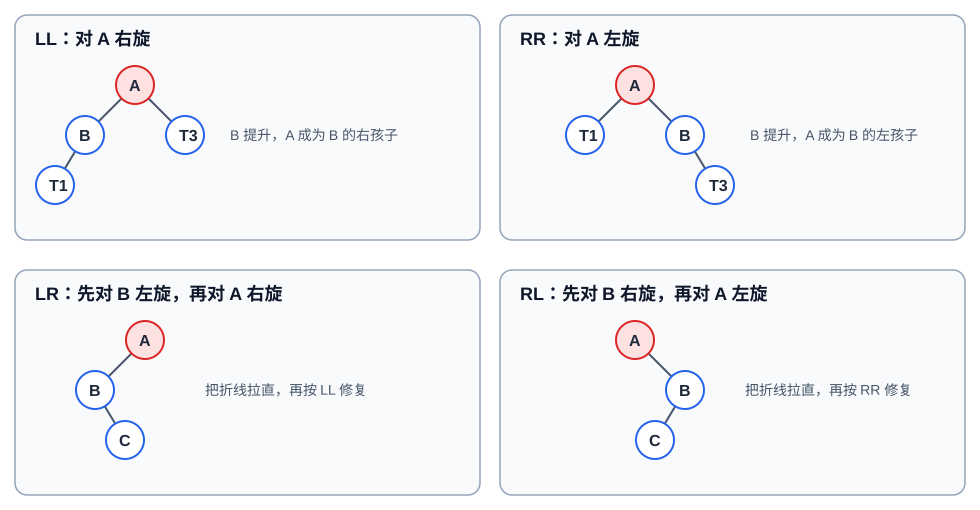

# 平衡二叉树（AVL 树）

平衡二叉树（AVL 树）首先是一棵[二叉排序树](./binary-search-tree.md)，并通过限制每个节点两侧子树的高度差，避免树退化成链表。它是 408 中的重点：需要判断平衡、确定失衡类型，并写出旋转后的局部结构。

## 定义与平衡因子

设节点 $x$ 的左右子树高度分别为 $h_L$、$h_R$，其平衡因子为：

$$
BF(x)=h_L-h_R
$$

AVL 树要求每个节点都满足：

$$
|BF(x)|\le1
$$

因此 $BF=1$ 表示左高，$BF=-1$ 表示右高，$BF=0$ 表示等高。高度的起始约定可以不同（空树高度为 $-1$ 或 $0$），但同一道题中必须保持一致；平衡因子和旋转类型不受该起始约定影响。

## 为什么能保证对数高度

高度为 $h$ 的 AVL 树要尽量少节点时，一边子树高度为 $h-1$，另一边只能为 $h-2$，故最少节点数满足：

$$
N_h=N_{h-1}+N_{h-2}+1
$$

它按 Fibonacci 数增长，因此高度为 $O(\log n)$。查找、插入、删除均沿一条根叶路径进行，时间复杂度都是 $O(\log n)$。

## 失衡与旋转

插入或删除后，从变化位置向根回溯，找到第一个 $|BF|=2$ 的节点 $A$。设 $A$ 较高一侧的孩子为 $B$，$B$ 较高一侧的孩子为 $C$：

*图：红色节点是最低失衡节点 $A$。LR、RL 必须先把折线变直，再处理为 LL、RR。*

| 类型 | 路径方向 | 修复 | 旋转后局部根 |
| --- | --- | --- | --- |
| LL | $A\rightarrow B\rightarrow C$ 均向左 | 对 $A$ 右单旋 | $B$ |
| RR | $A\rightarrow B\rightarrow C$ 均向右 | 对 $A$ 左单旋 | $B$ |
| LR | 先左再右 | 先对 $B$ 左旋，再对 $A$ 右旋 | $C$ |
| RL | 先右再左 | 先对 $B$ 右旋，再对 $A$ 左旋 | $C$ |

### 单旋为何不破坏二叉排序树

以 LL 的右旋为例，原来满足：

$$
T_1 < B < T_2 < A < T_3
$$

右旋后 $B$ 成为局部根，$A$ 成为其右孩子，$T_2$ 改为 $A$ 的左子树；中序序列仍是 $T_1,B,T_2,A,T_3$，所以二叉排序树性质不变。RR 左旋完全镜像。

### 双旋的关键

LR 中，新增节点位于 $A$ 的左孩子 $B$ 的右子树。若直接对 $A$ 右旋，$B$ 会提升，但高度关系仍不对；先对 $B$ 左旋使 $C$ 提升，局部变成 LL，再对 $A$ 右旋。RL 同理。

## 插入后的调整

新键先按二叉排序树规则插入为叶子，再自底向上更新高度与平衡因子。

1. 若祖先的 $BF$ 从 $0$ 变为 $\pm1$，该子树高度增加，继续向上。
2. 若 $BF$ 从 $\pm1$ 变为 $0$，该子树高度没有增加，插入调整结束。
3. 首次出现 $|BF|=2$ 时，按 LL、RR、LR、RL 旋转；插入导致的最低失衡子树旋转后高度恢复，因此无需再向上旋转。

判断类型时看“插入点相对 $A$ 的路径”，不要只看新键大小。比如新键在 $A$ 的左子树但落在左孩子的右侧，就是 LR。

## 删除后的调整

删除先按二叉排序树处理：有两个孩子时，用前驱或后继替换，再删除至多一个孩子的节点。随后从实际删除位置向根回溯。

删除与插入的区别是：一次旋转后局部高度**可能继续降低**，所以仍可能使更高祖先失衡，必须持续回溯到根。

当 $A$ 左高（$BF(A)=2$）时，令 $B=A.left$：

| $BF(B)$ | 调整 | 旋转后高度变化 |
| --- | --- | --- |
| $1$ | LL：对 $A$ 右旋 | 子树高度降低，继续向上检查 |
| $0$ | 对 $A$ 右旋 | 子树高度不变，可以停止 |
| $-1$ | LR：先左旋 $B$，再右旋 $A$ | 子树高度降低，继续向上检查 |

$A$ 右高时完全镜像：$BF(B)=-1$ 对应 RR，$0$ 对应左单旋，$1$ 对应 RL。删除题中孩子平衡因子为 $0$ 的单旋情形是常见考点，不能按插入规则忽略。

## 与红黑树的关系

| 特性 | AVL 树 | [红黑树](./red-black-tree.md) |
| --- | --- | --- |
| 平衡条件 | 每个节点左右高度差至多 $1$ | 黑高相同、红节点不相邻 |
| 树高 | 更严格，通常更矮 | 约束较松 |
| 查找 | 通常常数更小 | 最坏仍为 $O(\log n)$ |
| 更新 | 删除时可能连续调整 | 旋转通常较少 |

查找明显多于更新时，AVL 的严格平衡很合适；频繁插删的通用有序映射常使用红黑树。

## 易错点

- AVL 的“平衡”不是左右子树节点数相等，而是**高度差绝对值不超过 $1$**。
- 旋转后要同时更新局部节点高度，通常先更新较低的旧根，再更新新根。
- 插入只需修复最低失衡节点；删除可能需要一直修复到根。
- LR、RL 都是两次旋转，不能把它们当作一次单旋。
- AVL 是二叉排序树，旋转前后中序遍历顺序不变。

## 参考

- [平衡二叉树（AVL）参考文章](https://zhuanlan.zhihu.com/p/551421983)：性质与旋转情形的参考；该页拒绝自动访问，图示改为本站 SVG 重绘。
