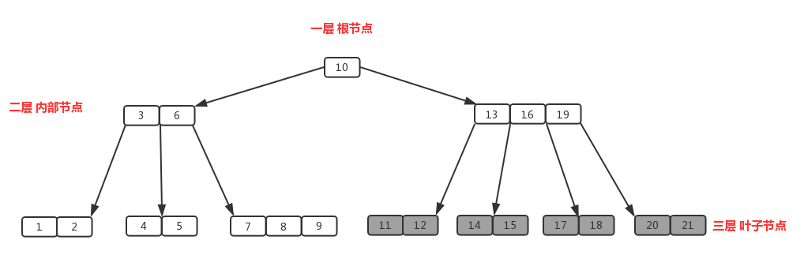
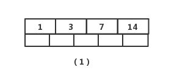
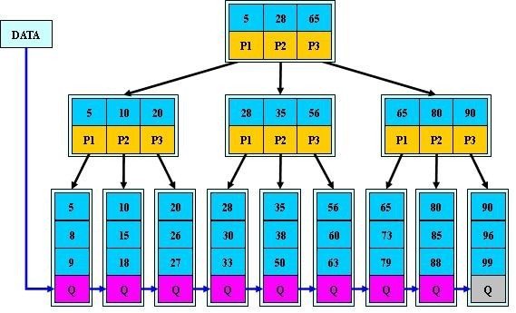

# B 树与 B+ 树

磁盘（或 SSD 的页）一次读取的是一整页数据，而不是一个关键字。若索引使用二叉树，树高很大，每向下一层都可能发生一次页 I/O。B 树把多个关键字和多个孩子放进同一页，以很大的**扇出**换取很小的树高；B+ 树进一步把全部记录放在叶子层，并把叶子串起来，因此特别适合数据库索引和范围扫描。

> **术语：**B-tree 就是 **B 树**，不是“B 减树”。下文的“关键字”指用于比较和定位的键；“记录”指该键对应的数据或数据指针。

## 为什么是多路树

一页大小若为 $4\,\mathrm{KiB}$，一个内部节点能够容纳数百个“关键字 + 子页指针”。假设每页可分出 $200$ 个孩子，三层就能覆盖约 $200^3=8\times10^6$ 个叶子范围。一次从根到叶子的查找通常只需数次页读取。

因此，外存索引关注的主要不是节点内比较的次数，而是**树高（页 I/O 次数）**。节点内部的有序关键字可用二分查找。

## B 树

### 定义与阶

$m$ 阶 B 树是平衡的 $m$ 路查找树。这里的“$m$ 阶”表示**一个节点最多有 $m$ 个孩子**，不是一个节点恰有 $m$ 个关键字。

- 每个节点最多有 $m$ 个孩子，因此最多有 $m-1$ 个关键字。
- 除根以外的每个节点至少有 $\lceil m/2\rceil$ 个孩子，因此至少有 $\lceil m/2\rceil-1$ 个关键字。
- 根若不是叶子，至少有 $2$ 个孩子、至少 $1$ 个关键字；根是唯一节点时可以没有关键字。
- 有 $k$ 个孩子的内部节点，恰有 $k-1$ 个关键字。若关键字为 $K_1<K_2<\cdots<K_{k-1}$，则 $C_0$ 中的键小于 $K_1$，$C_i$ 中的键位于 $(K_i,K_{i+1})$，$C_{k-1}$ 中的键大于 $K_{k-1}$。
- 所有叶子节点位于同一层。这里的叶子节点是**不含孩子指针的节点**，不是红黑树中表示空指针的 NIL。

例如，下图是一个 $4$ 阶 B 树：每个节点最多 $3$ 个关键字、最多 $4$ 个孩子；除根外至少 $1$ 个关键字。



*图：四阶 B 树中，一个节点的关键字将其孩子划分为多个有序区间。*

```text
                         [ 30 | 60 ]
                  /          |          \
          [ 10 | 20 ]     [ 40 | 50 ]   [ 70 | 80 | 90 ]
```

### 查找

在当前页的有序关键字中定位：命中则成功；未命中就沿对应区间的孩子指针继续。例如查找 $45$：在根的 $30$、$60$ 之间，进入中间孩子；再在 $40$、$50$ 之间，发现对应叶子中没有 $45$，查找失败。

若树高为 $h$，查找需要 $O(h)$ 次页访问。B 树保持平衡且扇出很大，所以 $h=O(\log_m n)$；节点内的二分比较不改变这一结论。

### 插入：满则分裂，中间键上升

插入总是在叶子节点完成。设节点最多容纳 $m-1$ 个关键字：

1. 按查找路径到达叶子，将新键插入该节点的有序位置。
2. 未超过 $m-1$ 个关键字时结束。
3. 溢出时，取**中间关键字**提升到父节点；中间键左、右两侧的关键字分别形成两个新节点。
4. 父节点也可能溢出，重复分裂；若根溢出，创建新根，树高加 $1$。

以 $4$ 阶 B 树为例，一个节点最多 $3$ 个键。向满叶子 `[10 | 20 | 30]` 插入 $25$ 后有 $4$ 个键，分裂并将 $25$ 上升：

```text
插入前： [ 10 | 20 | 30 ]

临时页： [ 10 | 20 | 25 | 30 ]
                     ↑
                 提升 25

分裂后：       [ 25 ]
               /    \
       [ 10 | 20 ]  [ 30 ]
```

考试中常用的理解是：**分裂的分隔键离开子节点，进入父节点**。因此 B 树的一个关键字只保留在一个节点中。



*图：B 树插入时，节点溢出后以中间关键字分裂，分隔键上升到父节点。*

### 删除：替换、借位、合并

删除后，非根节点不能少于 $\lceil m/2\rceil-1$ 个关键字。处理顺序如下。

1. 若待删键在内部节点，用其前驱（左子树最大键）或后继（右子树最小键）替换；实际删除转化为叶子删除。
2. 删除后仍满足最小关键字数，结束。
3. 若相邻兄弟有多余关键字，执行**借位（重分配）**：父节点的分隔键下移到当前节点，兄弟最靠近父节点的键上移成为新的分隔键；相应孩子指针也一起移动。
4. 若兄弟也正好在下限，执行**合并**：把父节点的分隔键下移，和两个相邻孩子合为一个节点；父节点少一个键，可能继续下溢。
5. 根没有关键字但仍有一个孩子时，令该孩子成为新根，树高减 $1$。

下图展示向右兄弟借位。当前节点删除后为空，右兄弟有多余键 `$50$`；父键 `$40$` 下移，兄弟最小键 `$50$` 上移：

```text
调整前：              [ 40 ]
                       /   \
                    [ ]   [ 50 | 60 ]

调整后：              [ 50 ]
                       /   \
                   [ 40 ] [ 60 ]
```

若右兄弟同样不能借，则把父键下移后合并，例如 `[10] + 20 + [30]` 合为 `[10 | 20 | 30]`。

### 高度与关键字数

设 $t=\lceil m/2\rceil$。根不是叶子时，根至少有 $2$ 个孩子，其他内部节点至少有 $t$ 个孩子。高度为 $h$（根在第 $1$ 层）的 B 树至少有：

$$
n_{\min}=2t^{h-1}-1
$$

个关键字。因此：

$$
h\le 1+\log_t\frac{n+1}{2}
$$

这说明即使每个节点只达到最低装载率，树高仍是对数级。

## B+ 树

### 性质

一棵 $m$ 阶 B+ 树满足：

- 每个节点至多有 $m$ 个关键字（元素），至多有 $m$ 棵子树。
- 除根节点外，每个节点至少有 $\lceil m/2\rceil$ 个关键字；内部节点也至少有同样多的子树。
- 根若不是叶子，至少有 $2$ 个关键字和 $2$ 棵子树；根若同时是叶子，可以只含一个关键字。
- 一个内部节点有 $n$ 个关键字，就**恰有 $n$ 棵子树**。设键为 $K_1<K_2<\cdots<K_n$，第 $i$ 棵子树中所有键都不小于 $K_i$，且（$i<n$ 时）小于 $K_{i+1}$；$K_i$ 是该子树最小键的副本。
- 所有叶子节点在同一层；叶子节点包含全部关键字和记录（或记录指针），并从小到大相互链接。
- 非叶节点只做索引，叶子节点才保存实际记录。叶子中的每个键可以在祖先索引节点中重复出现。

### 与 B 树的结构差异

B+ 树也是多路平衡查找树，但它把“索引”和“记录”分开：

- **内部节点只存导航键和孩子指针**，不保存完整记录。
- **所有记录（或记录指针）只在叶子节点**，同一关键字可在内部节点出现副本。
- 所有叶子在同一层，并按键值从小到大通过链表相连，通常实现为双向链表。
- 任意成功查找都必须走到叶子，所以路径长度稳定。

```text
内部索引页：              [ 10 | 30 | 60 ]
                         /       |        \
叶子记录页：      [10,20] ⇄ [30,40,50] ⇄ [60,70,80]
                  ↑                         ↑
                最小键                    最大键
```

上图中索引页有 $3$ 个关键字，也有 $3$ 棵子树：`10`、`30`、`60` 分别是三棵子树的最小键。这样才能和本节“$n$ 个关键字对应 $n$ 棵子树”的性质一致。



*图：B+ 树的记录集中在叶子页，叶子页按键值顺序相连。*

### 查找与范围查询

精确查找先从根定位到目标叶页，再在叶页查找。范围查询 `WHERE key BETWEEN L AND R` 先定位 $L$ 所在叶子，随后只沿叶子链向右扫描，直到超过 $R$ 为止；不需要回到父节点做中序遍历。

这也是 B+ 树最适合数据库范围查询、排序和顺序扫描的原因。

### 插入：叶子复制分隔键

新记录先插入叶页。叶页未满则结束；叶页满时分成左右叶页，**右叶页的最小键复制到父节点作为分隔键**。注意这个键仍保留在右叶页中，这一点与 B 树“中间键上升且离开子节点”不同。

```text
叶页满：[10 | 20 | 30]，插入 25

分裂后叶页： [10 | 20] ⇄ [25 | 30]
                           ↑
                将 25 复制到父索引页
```

若父索引页也满，则内部页分裂并继续向上传播。根分裂时新建根，树高加 $1$。工程实现有时会优先向未满的相邻叶页重分配，以减少页分裂；这不改变 B+ 树的基本性质。

### 删除：先维护叶页，再更新索引

从叶页删除记录后，仍保持该页有序。

1. 叶页装载量仍满足下限时结束；若被删除的是叶页最小键，按分隔键约定更新祖先索引。
2. 叶页下溢且兄弟有多余记录时，从兄弟借一条记录，并更新父分隔键。
3. 兄弟也不能借时，合并两个叶页，修复叶子链，再从父节点删除对应分隔键。
4. 内部节点下溢也按“借位或合并”处理；根只剩一个孩子时降低树高。

实现中的最小填充比例和分裂点可能由数据库页格式决定；教材题通常按“非根节点至少半满”计算。

## B 树与 B+ 树对比

| 特性 | B 树 | B+ 树 |
| --- | --- | --- |
| 完整记录的位置 | 所有节点都可能保存 | 仅叶子节点保存 |
| 内部键 | 是实际关键字，通常只出现一次 | 是导航副本，可与叶子重复 |
| $n$ 个关键字的内部节点 | 有 $n+1$ 棵子树 | 有 $n$ 棵子树（本笔记约定） |
| 成功查找终点 | 可能在内部节点 | 必定到叶子节点 |
| 范围/顺序访问 | 需跨层遍历 | 沿叶子链顺序扫描 |
| 内部页扇出 | 受记录大小影响 | 不存完整记录，通常更大 |
| 查询路径 | 长度可能不同 | 长度一致，性能更稳定 |

## 易错点

- B 树的阶是**最大孩子数**，不是最大关键字数；最大关键字数为 $m-1$。
- B+ 树最多有 $m$ 个关键字和 $m$ 棵子树；非根节点最少有 $\lceil m/2\rceil$ 个关键字。
- “所有叶子同层”是 B/B+ 树保持平衡的条件；不等同于二叉树的完全二叉树。
- B+ 树的内部键是索引副本；插入叶子分裂后，分隔键通常是**复制**到父节点，不是从叶子删除。
- B+ 树的范围查询高效依赖叶子链；不是从根节点反复查找区间内每个键。
- 不同教材对“阶”和内部键取左子树最大值/右子树最小值的约定可能不同，计算节点容量前先读题设。

## 参考

- [B 树、B+ 树与红黑树详解](https://www.cnblogs.com/henuliulei/p/15114440.html)：本文的结构与操作示意参考之一；定义、例子和表述均已重新组织撰写。
