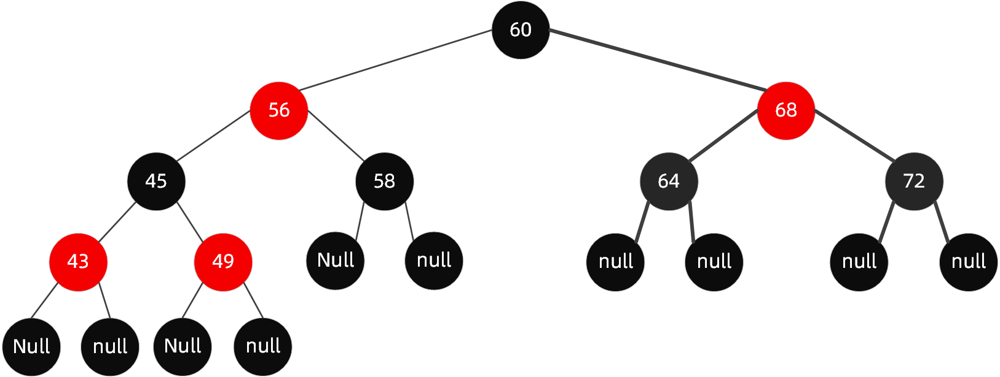

# 红黑树

红黑树（Red-Black Tree, RBT）是一种**自平衡二叉搜索树**。它不要求左右子树高度严格相等，而是用颜色限制最长路径与最短路径的比例，因此查找、插入、删除的最坏时间复杂度都为 $O(\log n)$。Java `TreeMap`、C++ `std::map` 和 Linux 内核中的许多有序容器都采用这一类思想。

## 性质与术语

约定每个空孩子都是黑色的 NIL 哨兵节点，NIL 不存实际键。红黑树满足：

1. 每个实际节点是红色或黑色。
2. 根节点为黑色。
3. 所有 NIL 叶子为黑色。
4. 红色节点的两个孩子都是黑色，即不能有连续的红色节点。
5. 从任一节点到其所有后代 NIL 叶子的路径，经过的黑色节点数相同。

从节点 $x$ 到任一后代 NIL 路径上的黑色节点数称为 $x$ 的**黑高**（black height）。第 5 条使同一节点两边黑高相等；第 4 条又限制了红色节点不能连续出现。

```text
                 8(B)
                /    \
             3(R)    12(R)
             /  \    /   \
          1(B) 6(B) 10(B) 14(B)
          / \   / \  / \    / \
        NIL NIL ...        NIL NIL
```

上图中 `B`、`R` 分别表示黑、红。实际实现通常用一个共享的黑色 NIL 节点代替每个空指针，便于统一处理删除。



*图：红黑树通过红黑颜色与相同黑高维持近似平衡。*

### 为什么它仍然足够平衡

设根到 NIL 的黑高为 $bh$。任一路径至少有 $bh$ 个黑节点；由“不连续红”可知，任一路径最多插入同样多的红节点，所以最长路径至多是最短路径的两倍。又因为黑高为 $bh$ 的子树至少含 $2^{bh}-1$ 个实际节点，可得：

$$
h\le 2\log_2(n+1)
$$

这就是红黑树所有基本操作保持 $O(\log n)$ 的原因。

### 为什么新节点先染红

按普通二叉搜索树规则插入位置。若新节点直接染黑，会使经过该位置的路径黑高加一，必定破坏第 5 条；染红不会改变黑高，只有“父节点也是红色”时才违反第 4 条，因此需要修复的情形更少。

## 基础操作：旋转

左旋与右旋只调整局部结构，**不改变中序遍历顺序**，因此仍是二叉搜索树。

```text
对 x 左旋：                         对 y 右旋（镜像）：

      x                                  y
     / \                                / \
    A   y          ==>                 x   C
       / \                            / \
      B   C                          A   B
```

颜色调整负责恢复黑高，旋转负责把“内侧”形状变成可处理的“外侧”形状，或把父节点提升到合适位置。

## 插入修复

新节点 $x$ 先染红。若父节点为黑色，所有性质仍成立，直接结束。若父节点 $P$ 为红色，祖父 $G$ 必为黑色；令 $U$ 为 $P$ 的兄弟（叔叔）。以下按 $P$ 是 $G$ 左孩子说明，右侧情形完全镜像。

### 情形 1：叔叔为红色——变色并向上继续

将 $P$、$U$ 染黑，$G$ 染红，然后把 $G$ 当成新的 $x$ 继续向上检查。根最终必须染黑。

```text
修复前：             G(B)                 修复后：            G(R)
                    /    \                                   /    \
                 P(R)    U(R)                             P(B)    U(B)
                 /                                          /
               x(R)                                      x(R)
```

局部两条路径的黑高仍相同；唯一可能的问题是 $G$ 的父节点也为红色，所以要向上继续。

### 情形 2：叔叔为黑色，且是内侧（LR）——先转成外侧

若 $P$ 是 $G$ 的左孩子、$x$ 是 $P$ 的右孩子，先对 $P$ 左旋；旋转后原来的 $x$ 成为该局部的父节点，形状变为 LL。右侧的 RL 情形先对 $P$ 右旋。

```text
        G(B)                         G(B)
        /                            /
     P(R)        对 P 左旋          x(R)
        \          ======>         /
        x(R)                      P(R)
```

### 情形 3：叔叔为黑色，且是外侧（LL）——旋转祖父并变色

将 $P$ 染黑、$G$ 染红，对 $G$ 右旋。RR 情形则交换左右、对 $G$ 左旋。

```text
修复前：             G(B)                 修复后：             P(B)
                    /                                      /    \
                 P(R)          G 右旋                    x(R)   G(R)
                 /              ======>
               x(R)
```

完成后局部黑高相等，且不再存在红红相邻。一次插入最多经历一次“叔叔红色”的向上传播，最后至多进行两次旋转。

### 插入例：依次插入 10、20、30、15

1. 插入 `10`：作为根，染黑。
2. 插入 `20`：红色右孩子，父为黑，结束。
3. 插入 `30`：父 `20` 红、叔叔为黑，属于 RR；对 `10` 左旋并变色，得到根 `20(B)`，左右为 `10(R)`、`30(R)`。
4. 插入 `15`：成为 `10` 的右孩子，父 `10` 和叔叔 `30` 都是红色；将 `10`、`30` 染黑，`20` 暂染红，再将根 `20` 染回黑色。

```text
              20(B)
             /     \
          10(B)    30(B)
              \
              15(R)
```

## 删除修复

删除先按二叉搜索树规则进行。若目标有两个非 NIL 孩子，先用前驱或后继的键替换它；随后真正被移除的节点至多有一个非 NIL 孩子。

- 删除红色节点，不改变任何路径黑高，直接结束。
- 删除黑色节点且其唯一孩子为红色：让该孩子顶替原节点并染黑，补回少掉的一层黑高。
- 删除黑色叶子会在该位置形成一个“**额外黑色**”（double black）的 NIL，需要修复。以下设 $x$ 是带额外黑色的左孩子，$S$ 是其右兄弟；右侧情形镜像处理。

### 情形 1：兄弟为红色——转换为兄弟黑色

此时父必为黑，$S$ 的两个孩子必为黑。将 $S$ 染黑、父染红，对父左旋；新的兄弟变黑后进入后续情形。

```text
        P(B)                         S(B)
       /   \        P 左旋          /   \
   x(DB)  S(R)      ======>      P(R)  SR(B)
          /  \                   /  \
       SL(B) SR(B)             x(DB) SL(B)
```

### 情形 2：兄弟黑色，两个侄子都黑——把额外黑色上推

将 $S$ 染红；若父是红色，将父染黑后结束，否则把父视为新的 double black，继续向上修复。

```text
      P(?)                         P(DB)
     /   \                       /    \
 x(DB)  S(B)   ==>             x(B)  S(R)
        /  \
     SL(B) SR(B)
```

### 情形 3：兄弟黑色，近侄子红、远侄子黑——转为情形 4

近侄子是 $S$ 的左孩子。将近侄子染黑、$S$ 染红，对 $S$ 右旋；这样得到“远侄子红”的情形。右侧情形完全镜像。

### 情形 4：兄弟黑色，远侄子红——旋转并结束

让 $S$ 取父节点原颜色，父染黑，远侄子染黑，对父左旋。额外黑色被消除，修复结束。

```text
修复前：              P(c)                    修复后：          S(c)
                     /    \                                     /    \
                  x(DB)  S(B)              P(B)              SR(B)
                         /   \              /   \
                      SL(?)  SR(R)        x(B) SL(?)
                     对 P 左旋
```

删除最多沿祖先链传播一次额外黑色，并在最后进行常数次旋转，所以仍为 $O(\log n)$。实现时不要把“删除修复的四种情况”死记为颜色表：始终先确认 $x$ 位于父的哪一侧，再将另一侧作为兄弟，近/远侄子均相对于 $x$ 定义。

## 与 AVL 树的选择

| 特性 | AVL 树 | 红黑树 |
| --- | --- | --- |
| 平衡约束 | 任意节点左右高度差至多 $1$ | 黑高相同、红节点不相邻 |
| 高度 | 通常更低 | 至多 $2\log_2(n+1)$ |
| 查询 | 常数通常更好 | $O(\log n)$ |
| 插入/删除 | 删除可能引起多次调整 | 约束较松，旋转通常更少 |
| 典型场景 | 查询明显多于更新 | 通用有序映射、更新频繁 |

## 易错点

- 空孩子（NIL）是黑色；它不是存储实际数据的叶子节点。
- 新节点“默认红色”是插入算法的策略，不是红黑树额外的定义性质。
- 红黑树不要求每个节点左右子树高度相同，只要求从某节点向下的各条路径**黑高**相同。
- 删除有两个孩子的节点时，先交换键再删除前驱/后继；真正被物理删除的节点最多一个非 NIL 孩子。
- LR/RL 不是直接对祖父做单旋：先在父节点处旋转，化为 LL/RR，再旋转祖父。

## 参考

- [B 树、B+ 树与红黑树详解](https://www.cnblogs.com/henuliulei/p/15114440.html)：本文的插入、删除情形组织参考之一；内容与示意图均重新撰写。
