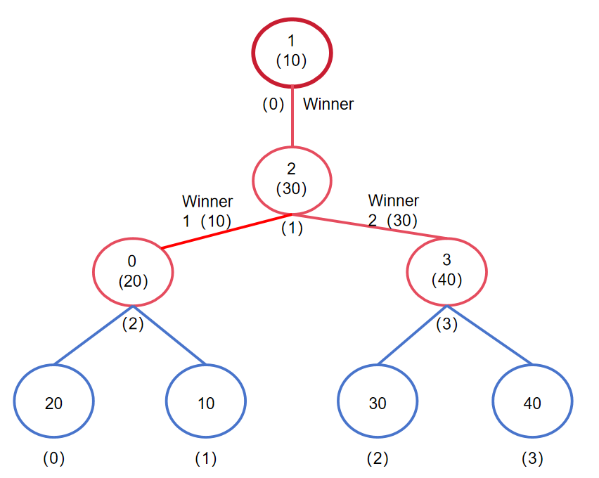

# 败者树

败者树（Loser Tree）是为 **$k$ 路归并**设计的完全二叉树。它持续维护 $k$ 个有序输入流当前首元素中的最小值（也可反向维护最大值），特别适用于外部排序：内存只保留每个归并段的一个当前记录，输出一个记录后只需沿一条路径更新。

## 核心想法

本文约定“小者胜”。每次比较有一个胜者和一个败者：

- 叶子代表一个输入流及其当前首元素。
- 内部节点保存该轮比较的**败者**；胜者继续向父节点参加下一轮比较。
- 根外额外保存最终胜者的输入流编号，因而能立刻取到全局最小元素。

内部节点不重复保存整个值，实际实现通常保存输入流编号；比较时通过编号读取各流当前首元素。某些教材采用“大者胜”的相反约定，只需整体交换“胜者”和“败者”的含义。



*图：四路败者树的结构示意，图片来自 OI OL。*

## 与锦标赛树的区别

| 结构 | 内部节点保存 | 根位置 | 更新后需要的信息 |
| --- | --- | --- | --- |
| 胜者树（锦标赛树） | 每一轮的胜者 | 根即全局胜者 | 重新比较路径上的胜者 |
| 败者树 | 每一轮的败者 | 根外保存全局胜者 | 新元素只与路径上的败者比较 |

败者树的优势是更新逻辑直接：替换一个叶子后，让新元素从该叶子向上“挑战”各层已经记录的败者；小者继续上行，大者留在当前内部节点。

## 初始化、建树与调整

设有 $k$ 个有序归并段，叶子 $i$ 对应当前元素 $a_i$。对耗尽的归并段使用哨兵 $+\infty$，这样它会一直落败，不会再被输出。

自底向上建树时，每个内部节点比较两个孩子传来的胜者，将较大者记录为败者、较小者上传。共有 $k-1$ 个内部节点，因此建树时间为 $O(k)$。

输出根外胜者所属归并段的当前元素后，从该段读入下一个元素（或替换为 $+\infty$）。设该叶的输入流编号为 $s$：

1. 将 $s$ 作为候选胜者，从叶子对应的父节点开始向上。
2. 在每个内部节点，将候选 $s$ 与该节点记录的败者比较。
3. 较小者继续向上；较大者留在当前节点，成为新的败者。
4. 到达根后，最终候选写入根外胜者位置。

一条根叶路径长度为 $\lceil\log_2 k\rceil$，一次调整为 $O(\log k)$。主归并过程只替换刚刚输出的输入流，其余 $k-1$ 个流的当前元素没有变化，所以不需要重建整棵树。

## 四路归并示例

```text
S0: 20    S1: 10    S2: 30    S3: 40
```

当前胜者是 `S1` 的 `10`。输出 `10` 后，假设 `S1` 的下一个元素为 `25`，只让 `S1` 沿根路径挑战此前记录的败者；最终胜者变为 `S0` 的 `20`。整个调整只经历两层比较，而不是重新扫描四个输入流。

## 复杂度与应用

| 操作 | 时间复杂度 |
| --- | --- |
| 建树 | $O(k)$ |
| 输出一个记录并调整 | $O(\log k)$ |
| 完成 $k$ 路归并（共 $N$ 条记录） | $O(N\log k)$ |
| 辅助空间 | $O(k)$ |

它常用于外部排序的多路归并、多个有序文件或日志流的在线合并。相比每次线性扫描 $k$ 个输入流，败者树把选择下一个记录的代价从 $O(k)$ 降为 $O(\log k)$。

## 易错点

- 根外保存最终**胜者**，内部节点保存路径上的**败者**。
- 输入流耗尽后放入 $+\infty$（最小归并）或 $-\infty$（最大归并），不要删除叶子。
- $k$ 是归并路数，$N$ 是总记录数；完整归并是 $O(N\log k)$。
- $k$ 不是 $2$ 的幂时，可补哨兵叶子到最近的完全二叉树规模，或用数组布局处理不完整最底层。

## 参考

- [OI OL：败者树](https://oi-ol.com/ds/loser-tree/)：结构图及概念参考。
