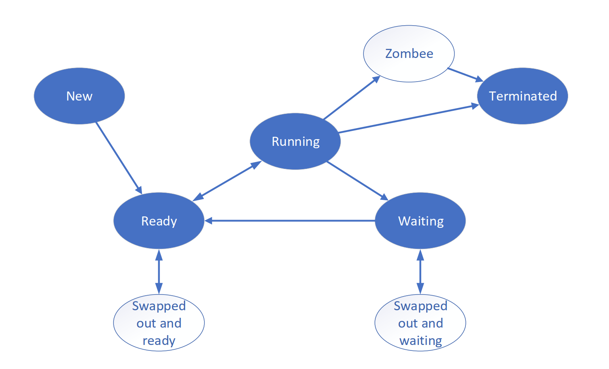

# OS Memory List: Key Concepts / 操作系统考点清单

每一条均为英文术语与中文释义的紧邻对照；复习时以英文定位教材术语，以中文理解考点。

## CH01 — Introduction / 概述

- **Operating system:** intermediary between users/programs and hardware; resource allocator and control program. / **操作系统**：用户、程序与硬件之间的中介；既是资源分配器，也是控制程序。
- **Goals:** convenience, efficiency, and ability to evolve; core concerns include virtualization and concurrency. / **目标**：方便性、有效性与可扩展性；核心问题包括虚拟化与并发。
- **Interrupt, exception/trap, system call, timer interrupt; user mode, kernel mode, privileged instruction.** / **中断、异常/陷阱、系统调用、时钟中断；用户态、内核态与特权指令。**
- **OS services:** program execution, I/O, file operations, communication, error detection, resource allocation, protection, security. / **操作系统服务**：程序执行、I/O、文件操作、通信、错误检测、资源分配、保护与安全。
- **Booting:** firmware/boot loader loads the kernel; the kernel initializes devices, interrupt vectors, and the first process. / **启动**：固件/引导程序装入内核；内核初始化设备、中断向量和首个进程。

## CH02 — OS Structures and System Calls / 操作系统结构与系统调用

- **API, system call, system program, command interpreter (shell).** / **API、系统调用、系统程序与命令解释器（Shell）。**
- **System-call parameters:** registers, memory block, or stack; path: trap → handler → return-from-trap. / **系统调用参数**：寄存器、内存块或栈；路径为陷阱 → 处理程序 → 陷阱返回。
- **Types:** process control, file management, device management, information maintenance, communication, protection. / **类型**：进程控制、文件管理、设备管理、信息维护、通信、保护。
- **System calls provide a controlled transition from user mode to kernel mode.** / **系统调用提供从用户态受控进入内核态的机制。**
- **Structures:** simple/monolithic, layered, microkernel, modular, hybrid; know their trade-offs. / **结构**：简单/单体、分层、微内核、模块化、混合；理解它们的取舍。

## CH03 — Processes and IPC / 进程与进程通信

- **Process memory layout:** text, data, heap, stack. / **进程内存布局**：代码段、数据段、堆、栈。
- **States:** new, ready, running, waiting/blocked, terminated; know transition causes. / **状态**：新建、就绪、运行、等待/阻塞、终止；掌握状态转换原因。

- **PCB:** process state, PC, registers, scheduling, memory, I/O, and file information. / **PCB**：进程状态、程序计数器、寄存器、调度、内存、I/O 与文件信息。
- **Context switch:** save one PCB context and restore another; it is overhead rather than useful user work. / **上下文切换**：保存一个 PCB 上下文并恢复另一个；它是开销，不做有效用户工作。
- **Queues and schedulers:** job/ready/device queues; long-, medium-, and short-term scheduler. / **队列与调度程序**：作业/就绪/设备队列；长程、中程、短程调度。
- **Creation and termination:** parent-child relation, `fork`, `exec`, `wait`; normal/abnormal termination, zombie, orphan. / **创建与终止**：父子关系、`fork`、`exec`、`wait`；正常/异常终止、僵尸、孤儿进程。
- **IPC:** shared memory and message passing; direct/indirect, blocking/nonblocking, zero/bounded/unbounded buffering. / **IPC**：共享内存与消息传递；直接/间接、阻塞/非阻塞、零/有界/无界缓冲。

## CH04 — Threads / 线程

- **Private:** thread ID, registers, stack. **Shared:** code, data, open files. / **私有**：线程 ID、寄存器、栈。**共享**：代码、数据、打开文件。
- **User threads and kernel threads; many-to-one, one-to-one, many-to-many, two-level models.** / **用户级与内核级线程；多对一、一对一、多对多、两层模型。**
- **`fork`/`exec`, thread cancellation, signal handling, TLS.** / **`fork`/`exec`、线程取消、信号处理、线程局部存储（TLS）。**
- **LWP, scheduler activations, upcalls, thread pools, fork-join, task-based parallelism.** / **轻量级进程、调度激活、upcall、线程池、fork-join、任务式并行。**

## CH05 — CPU Scheduling / CPU 调度

- **Scheduling points:** running→waiting, running→ready, waiting→ready, termination; preemptive vs non-preemptive. / **调度时机**：运行→阻塞、运行→就绪、阻塞→就绪、终止；抢占式与非抢占式。
- **Dispatcher and dispatch latency.** / **调度程序（dispatcher）与调度延迟。**
- **Criteria:** CPU utilization, throughput, turnaround, waiting, response time. / **指标**：CPU 利用率、吞吐量、周转时间、等待时间、响应时间。
- **Algorithms:** FCFS, SJF, shortest-remaining-time first, priority, RR. / **算法**：FCFS、SJF、短剩余时间优先、优先级、时间片轮转。
- **Multilevel queue, MLFQ, starvation, aging; asymmetric and symmetric multiprocessing.** / **多级队列、MLFQ、饥饿、老化；非对称与对称多处理。**

## CH06 — Synchronization / 同步

- **Critical-section requirements:** mutual exclusion, progress, bounded waiting. / **临界区要求**：互斥、前进、有限等待。
- **Software:** Peterson, Bakery. **Hardware:** disable interrupts, Test-and-Set, Compare-and-Swap, Fetch-and-Add. / **软件**：Peterson、Bakery。**硬件**：关中断、Test-and-Set、Compare-and-Swap、Fetch-and-Add。
- **Mutex and spinlock; busy waiting versus blocking.** / **互斥锁与自旋锁；忙等与阻塞的区别。**
- **Semaphore `wait(P)` / `signal(V)`; counting and binary semaphore.** / **信号量 `wait(P)` / `signal(V)`；计数与二元信号量。**
- **Classical problems:** bounded buffer, readers-writers, dining philosophers. / **经典问题**：生产者—消费者、读者—写者、哲学家进餐。
- **Monitor and condition variable; `wait` releases the monitor lock, `signal` wakes a waiter.** / **管程与条件变量；`wait` 释放管程锁，`signal` 唤醒等待者。**

## CH07 — Deadlocks / 死锁

- **Necessary conditions:** mutual exclusion, hold and wait, no preemption, circular wait. / **必要条件**：互斥、请求并保持、不可剥夺、循环等待。
- **Handling:** ignore, prevention, avoidance, detection, recovery. / **处理**：忽略、预防、避免、检测、解除。
- **Resource-allocation graph:** request edge and assignment edge; distinguish single and multiple instances. / **资源分配图**：请求边与分配边；区分单实例与多实例资源。
- **Banker’s algorithm:** `Available`, `Max`, `Allocation`, `Need`, safe state and safe sequence. / **银行家算法**：`Available`、`Max`、`Allocation`、`Need`，安全状态与安全序列。
- **Recovery:** terminate processes, preempt resources, rollback; understand cost and starvation. / **解除**：终止进程、资源抢占、回滚；理解代价与饥饿。

## CH08 — Main Memory / 内存管理基础

- **Binding:** compile time, load time, execution time; dynamic loading/linking. / **地址绑定**：编译时、装入时、执行时；动态装入/链接。
- **Logical/virtual address and physical address; MMU, relocation, base and limit registers.** / **逻辑/虚拟地址与物理地址；MMU、重定位、基址和界限寄存器。**
- **Contiguous allocation:** fixed/variable partitions, first/next/best/worst fit, compaction. / **连续分配**：固定/可变分区、首次/循环首次/最佳/最坏适应、紧凑。
- **Internal versus external fragmentation.** / **内部碎片与外部碎片。**
- **Segmentation:** segment table, segment number + offset, base/limit, sharing/protection, external fragmentation. / **分段**：段表、段号+偏移、基址/界限、共享/保护、外部碎片。
- **Paging:** page, frame, page table, VPN, offset, PFN; perform address translation and page-size calculation. / **分页**：页、页框、页表、VPN、页内偏移、PFN；会做地址转换和页大小计算。
- **PTE/frame-table bits:** valid/present, protection, reference, dirty. / **页表项/页框表位**：有效/存在、保护、引用、修改/脏位。
- **TLB:** hit, miss, TLB reach, effective access time (EAT). / **TLB**：命中、未命中、TLB reach、有效访问时间（EAT）。
- **Page-table structures:** multilevel, hashed, clustered, inverted; segmentation with paging; swapping. / **页表结构**：多级、哈希、聚簇、反置；段页式与交换。

## CH09 — Virtual Memory / 虚拟内存

- **Backing store and demand paging; logical memory can exceed physical memory.** / **后备存储与按需分页；逻辑内存可大于物理内存。**
- **Page fault:** validate → get free frame/select victim → write back dirty page if needed → read in → update tables → restart. / **缺页**：合法性检查 → 找空闲页框/选牺牲页 → 必要时回写脏页 → 调入 → 更新表项 → 重启。
- **Distinguish a page-not-present fault from an illegal address.** / **区分页不在内存导致的缺页与非法地址访问。**
- **Replacement:** OPT, FIFO, LRU; Bélády’s anomaly; stack property of OPT/LRU. / **置换**：OPT、FIFO、LRU；Bélády 异常；OPT/LRU 的栈性质。
- **LRU approximation:** reference bit, additional-reference-bits, second chance/clock. / **LRU 近似**：引用位、附加引用位、第二次机会/时钟。
- **Frame allocation:** equal, proportional, priority; global versus local replacement. / **页框分配**：平均、按比例、优先级；全局与局部置换。
- **Thrashing:** locality, working set/window, page-fault frequency (PFF). / **抖动**：局部性、工作集/窗口、页面错误频率（PFF）。
- **Copy-on-write, shared pages, memory-mapped files.** / **写时复制、共享页、内存映射文件。**

## CH10 — Mass Storage / 外存与磁盘调度

- **Disk:** platter, track, sector, cylinder, read-write head; seek, rotational delay, transfer time. / **磁盘**：盘片、磁道、扇区、柱面、读写头；寻道、旋转延迟、传输时间。
- **Scheduling:** FCFS, SSTF, SCAN, C-SCAN, LOOK, C-LOOK; calculate order and total head movement. / **调度**：FCFS、SSTF、SCAN、C-SCAN、LOOK、C-LOOK；会算顺序与总移动量。
- **Formatting, partitioning, boot block; RAID 0/1/0+1/1+0/4/5.** / **格式化、分区、引导块；RAID 0/1/0+1/1+0/4/5。**
- **SSD:** performance characteristics, erase endurance, wear leveling. / **固态硬盘**：性能特点、擦写寿命、磨损均衡。

## CH11 — Files and Directories / 文件与目录

- **File metadata, create/delete/open/close/read/write/seek, protection, access methods.** / **文件元数据、建立/删除/打开/关闭/读/写/定位、保护、访问方法。**
- **Directories:** single-level, two-level, tree, acyclic graph, general graph; operations and path resolution. / **目录**：单级、两级、树形、无环图、通用图；操作与路径解析。
- **Hard link versus symbolic link:** inode sharing versus stored path. / **硬链接与软链接**：共享 inode 与保存路径的区别。

## CH12 — File-System Implementation / 文件系统实现

- **Layout:** boot block, superblock/volume control block, directory, inode/FCB, data blocks; in-memory mount/open-file tables and buffers. / **布局**：引导块、超级块/卷控制块、目录、inode/FCB、数据块；内存挂载/打开文件表和缓冲区。
- **Allocation:** contiguous, linked, indexed; compare random access, fragmentation, reliability. / **分配**：连续、链接、索引；比较随机访问、碎片、可靠性。
- **FAT and inode/FCB; index blocks and multilevel indexing.** / **FAT 与 inode/FCB；索引块和多级索引。**
- **Free space:** bitmap, linked list, grouping, counting. / **空闲空间**：位图、链表、成组链接、计数。
- **VFS, mounting, consistency, recovery.** / **VFS、挂载、一致性、恢复。**

## CH13 — I/O Management / I/O 管理

- **Devices:** character, block, network; controller, interface, I/O port. / **设备**：字符、块、网络设备；控制器、接口、I/O 端口。
- **Control:** polling, interrupt-driven I/O, DMA; compare CPU involvement and use cases. / **控制方式**：轮询、中断驱动、DMA；比较 CPU 参与度与适用场景。
- **Software layers:** interrupt handler, driver, device-independent software, user-level I/O. / **软件层次**：中断处理程序、驱动程序、设备独立软件、用户层 I/O。
- **Character/block/network interfaces; blocking and nonblocking I/O.** / **字符/块/网络接口；阻塞与非阻塞 I/O。**
- **Buffering, caching, spooling, device allocation/recovery, error handling.** / **缓冲、缓存、假脱机、设备分配/回收、错误处理。**

## 408 Self-check / 408 自检

- **Can you explain PCB, PTE, inode/FCB, and semaphore fields and roles?** / **能否说明 PCB、页表项、inode/FCB、信号量的字段和作用？**
- **Can you calculate scheduling metrics, TLB/EAT, address fields, page faults, replacement, disk movement, and a Banker safe sequence?** / **能否计算调度指标、TLB/EAT、地址字段、缺页/置换、磁盘移动量和银行家安全序列？**
- **Can you distinguish process/thread, user/kernel mode, logical/physical address, page/frame, two fragmentations, hard/soft link, polling/interrupt/DMA?** / **能否区分进程/线程、用户/内核态、逻辑/物理地址、页/页框、两类碎片、硬/软链接、轮询/中断/DMA？**
