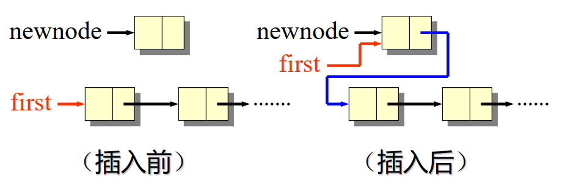
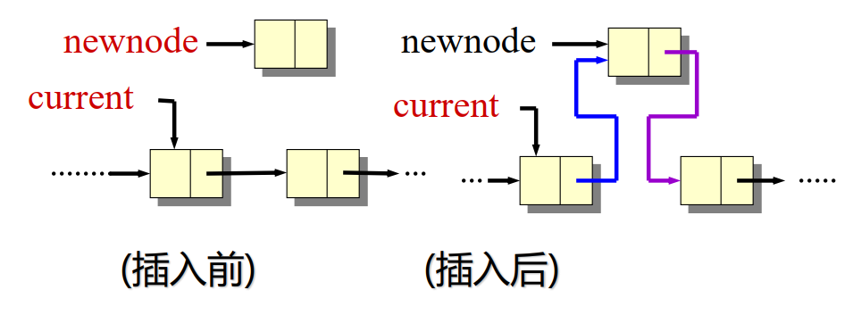
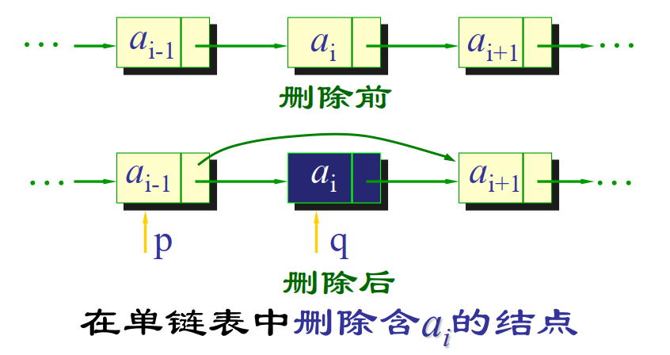

# Linked List 链表

Linked List 是一种动态数据结构，由节点组成，每个节点包含数据和指向下一个节点的指针。主要特点包括：
- 动态大小：链表可以根据需要动态增长或缩小。
- 插入和删除操作快速：在已知节点位置时，只需调整指针，时间复杂度为 $O(1)$。
- 访问元素较慢：需要从头节点开始遍历，时间复杂度为 $O(n)$。

常见链表类型：
- 单链表：每个节点只有 `next` 指针。
- 双链表：每个节点有 `prev` 和 `next` 两个指针。
- 循环链表：尾节点指回头节点，常用于循环模拟。

常见复杂度：

| 操作 | 复杂度 |
| --- | --- |
| 访问第 i 个节点 | $O(n)$ |
| 已知前驱节点后插入 | $O(1)$ |
| 已知前驱节点后删除 | $O(1)$ |
| 查找指定值 | $O(n)$ |

下面展示 C++ 实现的链表。

## 节点与链表类

```cpp
struct Node { // 单链表节点
    int data;
    Node* next;
};

class LinkedList { // 单链表
public:
    Node* head;

    LinkedList() {
        head = nullptr;
    }

    void insert(int i, int data); // 插入
    void remove(int i); // 删除
    int get(int i); // 访问
};

struct DoubleNode { // 双链表节点
    int data;
    DoubleNode* next;
    DoubleNode* prev;
};

class DoublyLinkedList { // 双链表
public:
    DoubleNode* head;
    DoubleNode* tail;

    DoublyLinkedList() {
        head = nullptr;
        tail = nullptr;
    }

    void insert(int i, int data); // 插入
    void remove(int i); // 删除
    int get(int i); // 访问
};
```

## 插入

单链表的插入，分为在头部插入和在其他位置插入。

```cpp
newnode->next = head;
head = newnode;
```



```cpp
newnode->next = current->next; // current 是第 i-1 个节点
current->next = newnode;
```



```cpp
void LinkedList::insert(int i, int data) {
    Node* newnode = new Node();
    newnode->data = data;
    if (i == 0) {
        newnode->next = head;
        head = newnode;
    } else {
        Node* current = head;
        for (int index = 0; index < i - 1 && current != nullptr; index++) {
            current = current->next;
        }
        if (current != nullptr) {
            newnode->next = current->next;
            current->next = newnode;
        }
    }
}
```

双链表插入时还要维护 `prev` 指针。

```cpp
newnode->next = current->next;
newnode->prev = current;
if (current->next != nullptr) {
    current->next->prev = newnode;
}
current->next = newnode;
```

## 删除

单链表删除头部节点：

```cpp
temp = head;
head = head->next;
delete temp;
```

删除其他位置节点：

```cpp
temp = current->next;
current->next = temp->next;
delete temp;
```



```cpp
void LinkedList::remove(int i) {
    if (head == nullptr) {
        return;
    }
    Node* temp;
    if (i == 0) {
        temp = head;
        head = head->next;
        delete temp;
    } else {
        Node* current = head;
        for (int index = 0; index < i - 1 && current->next != nullptr; index++) {
            current = current->next;
        }
        if (current->next != nullptr) {
            temp = current->next;
            current->next = temp->next;
            delete temp;
        }
    }
}
```

## Dummy 虚拟头节点

链表题中经常使用 dummy 节点简化头节点被删除或替换的情况。

```cpp
ListNode* dummy = new ListNode(0);
dummy->next = head;

// 对 dummy->next 做统一操作

return dummy->next;
```

没有 dummy 时，删除头节点通常需要单独判断；有 dummy 后，头节点和中间节点可以使用同一套逻辑。

## 快慢指针

快慢指针常用于链表环、链表中点、倒数第 k 个节点。

```cpp
ListNode* slow = head;
ListNode* fast = head;

while (fast != nullptr && fast->next != nullptr) {
    slow = slow->next;
    fast = fast->next->next;
}
```

循环结束时，`slow` 通常位于中点附近。若链表有环，快慢指针最终会相遇。

## 指针修改顺序

链表操作最容易错在断链。修改指针前，先保存后续节点。

反转链表的标准写法：

```cpp
ListNode* prev = nullptr;
ListNode* cur = head;

while (cur != nullptr) {
    ListNode* next = cur->next;
    cur->next = prev;
    prev = cur;
    cur = next;
}

return prev;
```

核心顺序是：先保存 `next`，再改 `cur->next`。

## 访问

```cpp
int LinkedList::get(int i) {
    Node* current = head;
    for (int index = 0; index < i && current != nullptr; index++) {
        current = current->next;
    }
    if (current != nullptr) {
        return current->data;
    }
    return -1;
}
```

# 常见题型

- 反转链表
- 快慢指针找环
- 删除倒数第 N 个节点
- 合并有序链表
- K 个一组翻转链表

# 语言库速查

- [C++ STL](../basics/cpp-stl.md)
- [Python Library](../basics/python-library.md)
- [Java Library](../basics/java-library.md)
